# Vehicle Breakdown: Scenarios, UI Steps and Flows

What happens when a vehicle breaks down, and exactly what the supervisor
does on screen for each situation: reporting, approving, moving the other
trips, running the next days on another vehicle, and bringing the vehicle
back after repair.

> Flow charts are [Mermaid](https://mermaid.js.org/). GitHub renders them
> directly; in VS Code install **Markdown Preview Mermaid Support**.

**Contents**

1. [Rules at a glance](#1-rules-at-a-glance)
2. [Screens used](#2-screens-used)
3. [The basic procedures (P1–P7)](#3-the-basic-procedures)
4. [Scenarios S1–S15 with steps and flow charts](#4-scenarios)
5. [Worked example over four days](#5-worked-example)
6. [Behind the screens: scheduler and status rules](#6-behind-the-screens)
7. [API reference](#7-api-reference)
8. [Not covered / known gaps](#8-not-covered--known-gaps)
9. [Code map and tests](#9-code-map-and-tests)

---

## 1. Rules at a glance

| Rule | Behaviour |
|---|---|
| Vehicle status | Every vehicle has an **Operational Status**: **Active** or **Breakdown**. Nobody edits it by hand — breakdowns change it. |
| Becomes **Breakdown** | As soon as a breakdown is **reported** (web, mobile app or Excel upload). |
| Back to **Active** | When **every** open breakdown of the vehicle is closed: **Rejected**, **Deleted**, or **Mark Vehicle Repaired**. |
| Starting a trip | A **Scheduled** trip whose vehicle is under breakdown **cannot start** (app or web). A trip that is already running is never blocked. |
| The trip it broke down on | On **Verify & Approve** its remaining stops move to a **new trip on the replacement vehicle**. |
| Its other trips (not started yet) | Listed in **Verify & Approve**. Ticked → moved to the replacement vehicle with their **own crew**. Unticked → stay with a red **Vehicle under breakdown** tag. |
| The following days | Ticked trip plans run on the replacement vehicle with the **plan's own crew** until the vehicle is repaired (a *vehicle substitution*). |
| No replacement for a day | That plan gets **no trip**; its supervisor gets **one** "Trip not created" notification per day. |
| Replacement vehicle | Never a vehicle that is itself under breakdown. If it already has work then, the supervisor is **warned** and must confirm. |
| Repair | **Mark Vehicle Repaired** → vehicle **Active**, its plans go back to it from the next trip. |

---

## 2. Screens used

| Menu | Screen | Used for |
|---|---|---|
| **Daily Operations → Vehicle Breakdown** | Breakdown list | **Report Breakdown**; row menu **⋮**: View Changes, **Verify & Approve**, **Reject**, **Mark Vehicle Repaired**, Edit, Delete. Column **Vehicle**: Under Breakdown / Repaired. |
| **Daily Operations → Daily Trip Plan** | Daily trips for a **Trip date** | Red **Vehicle under breakdown** tag; row **⋮ → Change Vehicle**; buttons **Run Scheduler**, **Generate Daily**. |
| **Schedule Setup → Trip Plans** | Trip plan list | Vehicle column badges **Under breakdown** / **Running on …**; row **⋮ → Use another vehicle / Change replacement vehicle / Stop using replacement**. |
| **Transport Masters → Vehicle Creation** | Vehicle master | Read-only **Operational Status** column (Active / Breakdown). |
| **Vehicle Status** dashboard | Fleet view | Shows a vehicle as *breakdown* until it is repaired. |
| Driver / supervisor mobile app | Trip screens | Driver reports a breakdown; supervisor gets a notification and can approve. |

Row actions shown on the Vehicle Breakdown list:

| Breakdown state | ⋮ menu shows |
|---|---|
| Pending | View Changes, **Verify & Approve**, **Reject**, Edit, Delete |
| Approved, vehicle not repaired | View Changes, **Mark Vehicle Repaired** |
| Approved and repaired / Rejected | View Changes |

(Verify, Reject, Mark Repaired and Edit need **edit** permission on the screen.)

---

## 3. The basic procedures

Every scenario in section 4 is a combination of these procedures.

### P1 — Report a breakdown (web)

1. Open **Daily Operations → Vehicle Breakdown** and click **Report Breakdown**.
2. **Scope**: choose **Company** and **Project**.
3. **Breakdown Details**:
   1. **Trip Assignment** — the trip the vehicle broke down on (not a
      Completed/Cancelled trip). **Broken Vehicle**, **Original Driver** and
      **Original Operator** fill in automatically.
   2. **Breakdown Reason** (Flat Tyre, Engine Failure, Accident, Electrical
      Fault, Overheating, Other).
   3. **Breakdown Latitude / Longitude** — type them or click **Detect**.
   4. Optional: Breakdown Time, Collected Weight Before Breakdown (kg),
      Breakdown Location, Breakdown Remarks, Photos.
4. **Replacement Arrangement**:
   1. **Replacement Vehicle** — the list shows only vehicles that are active,
      **not under breakdown**, have **no Scheduled / In Progress trip on that
      date**, and are not already promised to another pending breakdown.
   2. **Replacement Staff Template** — **pre-selected to the same crew**
      (marked *"(same crew)"*). Change it only if the crew cannot continue.
5. Click **Report Breakdown**.

Result: breakdown **Reported / Pending**; vehicle → **Breakdown**; the trip's
supervisor gets a "Vehicle breakdown reported" notification.

*From the mobile app:* the driver reports the breakdown on the trip; the
same thing happens. The replacement is usually picked by the supervisor at
approval.

### P2 — Verify & Approve

1. **Vehicle Breakdown** list → row **⋮ → Verify & Approve**.
2. Check the summary: Trip, Broken Vehicle, **Replacement Vehicle**,
   Replacement Driver/Operator (*"(same crew)"* when no other crew was picked).
3. **Remaining collection points** (bin trips): untick any stop that should
   **not** move to the replacement trip. Household stops always move.
4. **Other trips of \<vehicle\>** (only if it has trips not started yet):
   - Ticked = **move to the replacement vehicle** with their own crew.
   - A trip is **unticked by default** when the replacement already has
     another trip that day; the warning names it:
     *"⚠ TN01SPARE already has TRIP-… at 11:30 that day."*
5. **Use \<replacement\> for upcoming days until repaired** (one row per trip
   plan of the broken vehicle):
   - Ticked = from the **next day**, that plan's trips run on the replacement
     with the plan's own crew, until the vehicle is repaired.
   - **Unticked by default** when the replacement already runs its own plan
     (or stands in for another one) on the same weekdays; the warning names
     the plan and the days.
6. Optional **Remarks** → click **Approve & Start Replacement Trip**.
7. Read the result:
   - "Approved" — continuation trip created, *N* trips moved, *M* trip plans
     will run on the replacement.
   - "Approved — some trips were not moved" — those trips clashed with a
     replacement trip at the **same date and time**; move them with **P4**.

To change the replacement vehicle or crew **before** approving: **⋮ → Edit**
(only while Pending), then Verify again.

### P3 — Reject (not a real breakdown)

1. **Vehicle Breakdown** → **⋮ → Reject**.
2. Enter the **Rejection Reason** (required) → **Reject**.

Result: breakdown **Rejected**; vehicle → **Active** (if it has no other open
breakdown); the driver is notified; the trip carries on with its own vehicle.

### P4 — Move a blocked trip to another vehicle

1. **Daily Operations → Daily Trip Plan**, set **Trip date**.
2. Find the trip with the red **Vehicle under breakdown · \<vehicle\>** tag.
3. **⋮ → Change Vehicle** → choose **New vehicle** → **Change Vehicle**.

The list shows only active vehicles of the project that are not under
breakdown. It is refused if that vehicle already has a trip at the **same
date and time**. The crew stays the same; the red tag disappears.

### P5 — Set (or change) a replacement vehicle for upcoming days

1. **Schedule Setup → Trip Plans**. A plan whose vehicle is broken shows
   **Under breakdown** under the vehicle.
2. **⋮ → Use another vehicle** (or **Change replacement vehicle**).
3. Choose **Vehicle** and **From date** (today or later) → **Save**.
4. If that vehicle already has regular work on the plan's days, a
   **"Vehicle already busy"** box lists it → **Yes, use it** to confirm, or
   **Cancel**.
5. The plan now shows **Running on \<vehicle\>**.
6. **For today's trip:** go to **Daily Trip Plan** and click **Generate
   Daily** (or **Run Scheduler**) for today.

### P6 — Stop using the replacement vehicle

1. **Trip Plans** → **⋮ → Stop using replacement** → **Yes, stop**.

While the plan's own vehicle is still under breakdown, the plan then gets
**no trip** (and the supervisor is alerted each day).

### P7 — Mark the vehicle repaired

1. **Vehicle Breakdown** → the approved breakdown → **⋮ → Mark Vehicle Repaired**.
2. Optional **Repair Remarks** → **Mark Repaired**.

Result: vehicle → **Active** (once no other breakdown is open); every
replacement-vehicle arrangement for it ends; its plans go back to it from the
next generated trip; blocked trips can start again.

---

## 4. Scenarios

Legend for flow charts: rounded = supervisor action on screen, rectangle =
what the system does, diamond = decision.

### S1 — Breaks down mid-trip; the same crew carries on

**Situation:** 9:40 AM, Trip 1 in progress, engine fails. Driver and
operator are fine; a spare vehicle is free.

**Steps**

1. Report the breakdown (**P1**). In **Replacement Staff Template** keep the
   pre-selected *"(same crew)"* option.
2. **Verify & Approve** (**P2**) → **Approve & Start Replacement Trip**.
3. The crew sees the new trip on the spare vehicle in the app and continues
   with the remaining stops.

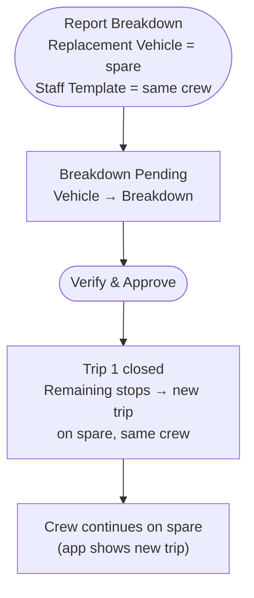

If the breakdown came from the **mobile app** and no crew was chosen, the
system uses the **same crew automatically**.

---

### S2 — Breaks down mid-trip; the crew cannot continue

**Situation:** accident; the driver is injured.

**Steps**

1. **P1**, but in **Replacement Staff Template** pick another crew (the list
   shows crews not on another active trip that day).
   *Already reported?* **⋮ → Edit** (while Pending) and change it.
2. **P2** → Approve.

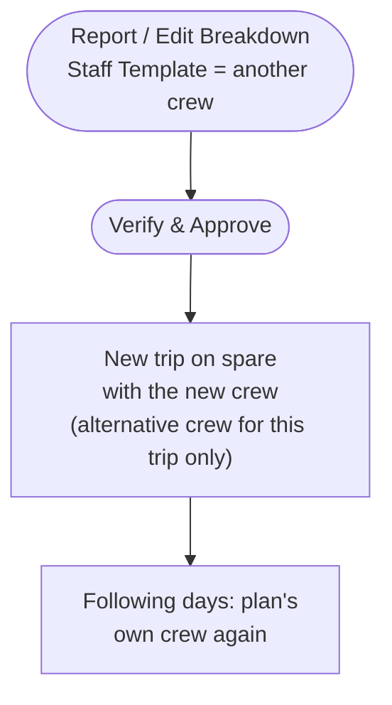

The new crew is used **only** for the replacement trip — it is not carried
into the following days.

---

### S3 — The vehicle has more trips today (or on later dates)

**Situation:** breaks down on Trip 1 (06:00). Trips 2 (11:00) and 3 (14:00)
are still Scheduled on the same vehicle.

**Steps**

1. **P1**, then **P2**.
2. In **Other trips of \<vehicle\>**: leave Trip 2 and Trip 3 **ticked** (the
   spare is free) → Approve.
3. Any trip you untick: move it later with **P4**, or leave it until the
   repair.

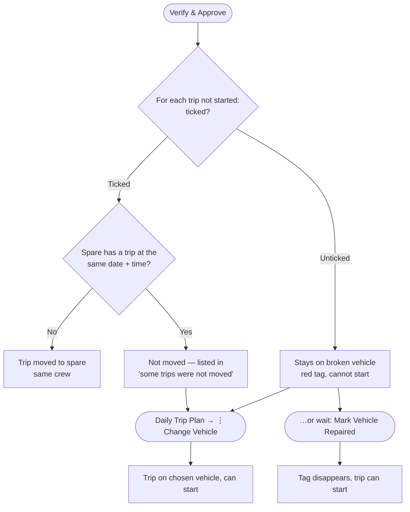

---

### S3a — The spare is free for one trip only

**Situation:** spare **B** can finish Trip 1, but B has its own trip at 11:30.

**Steps**

1. **P2**. Trip 2 (11:00) shows *"⚠ B already has TRIP-… at 11:30 that day"*
   and is **unticked** — leave it unticked → Approve.
2. **P4** for Trip 2: **Change Vehicle** to another vehicle **C**.
3. If no vehicle is free, leave it: it stays blocked until **P7**.

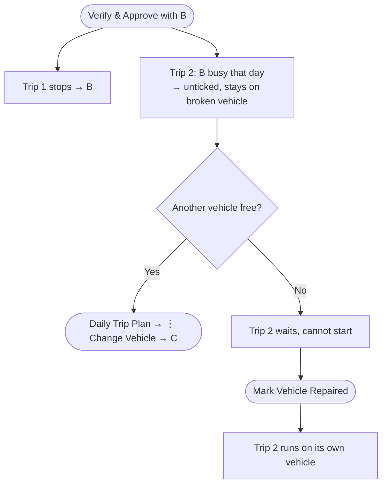

Note: the **Report Breakdown** form only offers vehicles with **no** trip on
that date, so a vehicle with its own trip that day can't be picked there.
The warnings above appear for later dates, or when the spare got work after
it was chosen.

---

### S4 — Next days: the crew is present, the vehicle is still broken *(main case)*

**Situation:** Tuesday's breakdown; the mechanic needs three days. The crew
comes to work on Wednesday.

**Steps**

1. **P2** on Tuesday. In **Use \<spare\> for upcoming days until repaired**
   keep the plan **ticked** (default) → Approve.
2. Nothing else. On Wednesday the scheduler creates the plan's trip on the
   spare with the plan's own crew; the crew sees it in the app as usual.
3. When the vehicle is fixed: **P7**.

*Forgot to tick it, or approved from the app with a busy spare?* Use **P5**
on the Trip Plans screen (and **Generate Daily** if today's trip is missing).

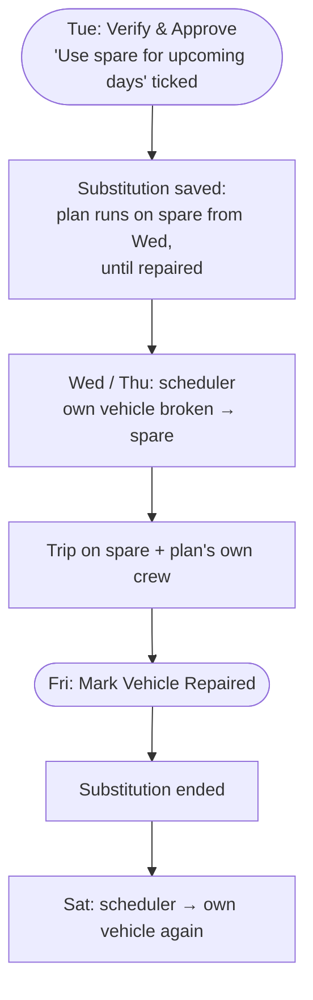

Why not a copy of the trip plan: a bin can belong to only one trip plan, so a
copy of a bin plan cannot be saved, and a copy would have to be deleted after
the repair (or the route is collected twice).

---

### S5 — The replacement already has its own trip plan

**Situation:** the "spare" runs its own route on Mon and Wed. The broken
plan runs Mon–Sat.

**Steps (at approval)**

1. **P2**: the plan row shows *"⚠ \<spare\> runs its own plan X at 06:00 on
   Mon, Wed"* and is **unticked**.
2. Decide:
   - Spare can do both routes on those days → **tick it** and approve.
   - It can't → leave it unticked, approve, then **P5** with another vehicle.

**Steps (from Trip Plans)**

1. **P5** → Save → **"Vehicle already busy"** lists the plan and days →
   **Yes, use it** or **Cancel** and pick another vehicle.

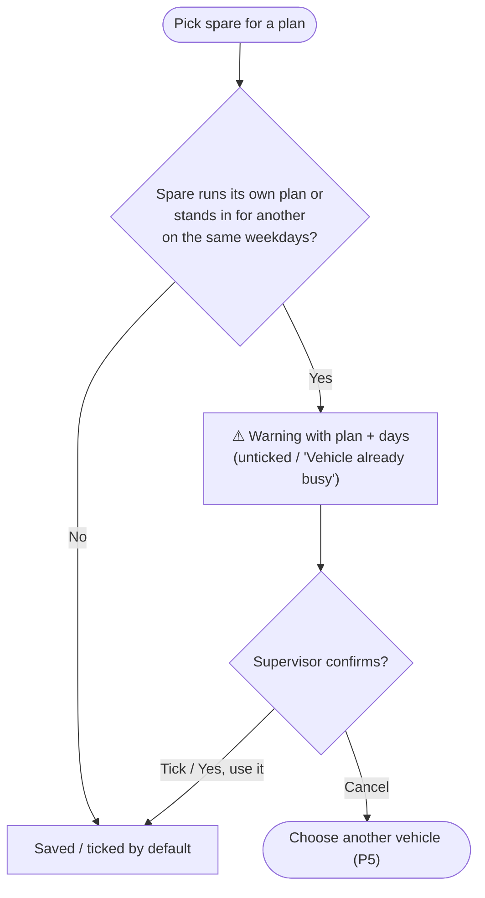

Days are compared by weekday: Mon–Sat vs a Wednesday-only spare clashes on
**Wed** only; Mon–Tue vs Wed does not clash. A plan with no repeat days
counts as every day.

---

### S6 — No free vehicle available

**Situation:** no spare today or tomorrow.

**Steps**

1. **P2** with whatever replacement you have for the current trip (or
   **untick** the upcoming-days plans).
2. Each day the plan has no replacement, the scheduler skips it and you get a
   **"Trip not created"** notification (once per plan per day).
3. When a vehicle becomes free: **P5**, then **Daily Trip Plan → Generate
   Daily** for today.

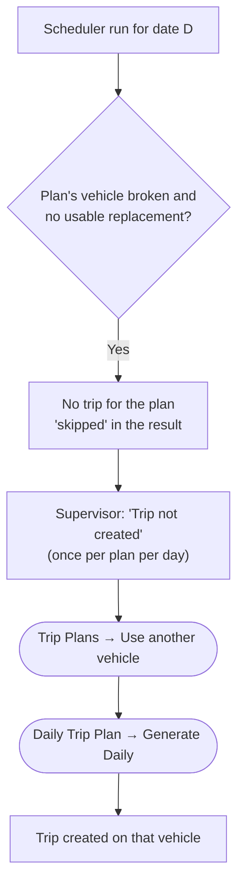

---

### S7 — The vehicle is repaired

**Steps**

1. **P7** (**Mark Vehicle Repaired**, optional remarks).
2. Check: **Vehicle Creation** shows **Active**; **Trip Plans** no longer
   shows *Under breakdown / Running on …*; blocked trips lost the red tag.

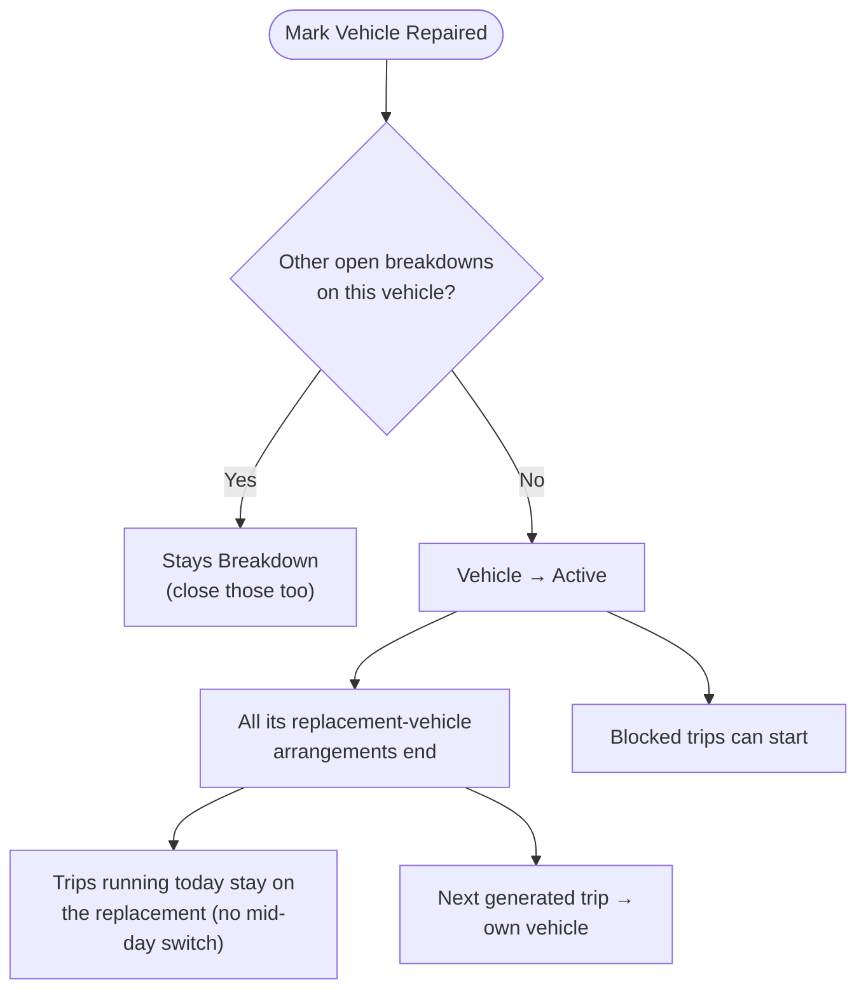

Only **approved** breakdowns can be marked repaired. A pending one is closed
with **Verify & Approve** or **Reject**.

---

### S8 — The replacement vehicle also breaks down

**Steps**

1. Report the spare's breakdown (**P1**) and handle it like any breakdown.
2. Plans that were running on the spare get **no trip** and you are alerted
   (*"replacement vehicle is also under breakdown"*).
3. **Trip Plans → ⋮ → Change replacement vehicle** (**P5**) with another
   vehicle; **Generate Daily** for today if needed.

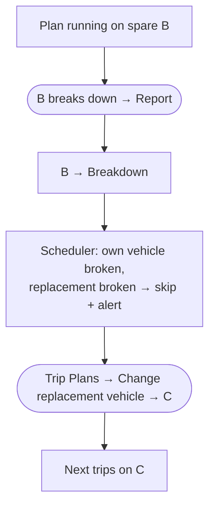

---

### S9 — Vehicle broken and crew on leave the same day

**Steps**

1. Vehicle: as in **S4** (replacement for upcoming days).
2. Crew: create the leave cover as usual in **Schedule Setup → Alternative
   Staff Template** with **From / To dates**, and get it **approved**.
3. Nothing else — the scheduler uses **both**: the replacement vehicle and
   the approved leave-cover crew for those dates.

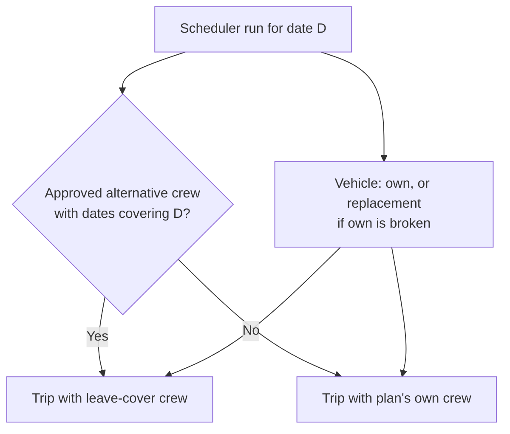

---

### S10 — Quick fix the same day (flat tyre)

**Steps**

- Still **Pending**: **P3 Reject** with reason "Fixed on the spot".
- Already **Approved**: **P7 Mark Vehicle Repaired**.

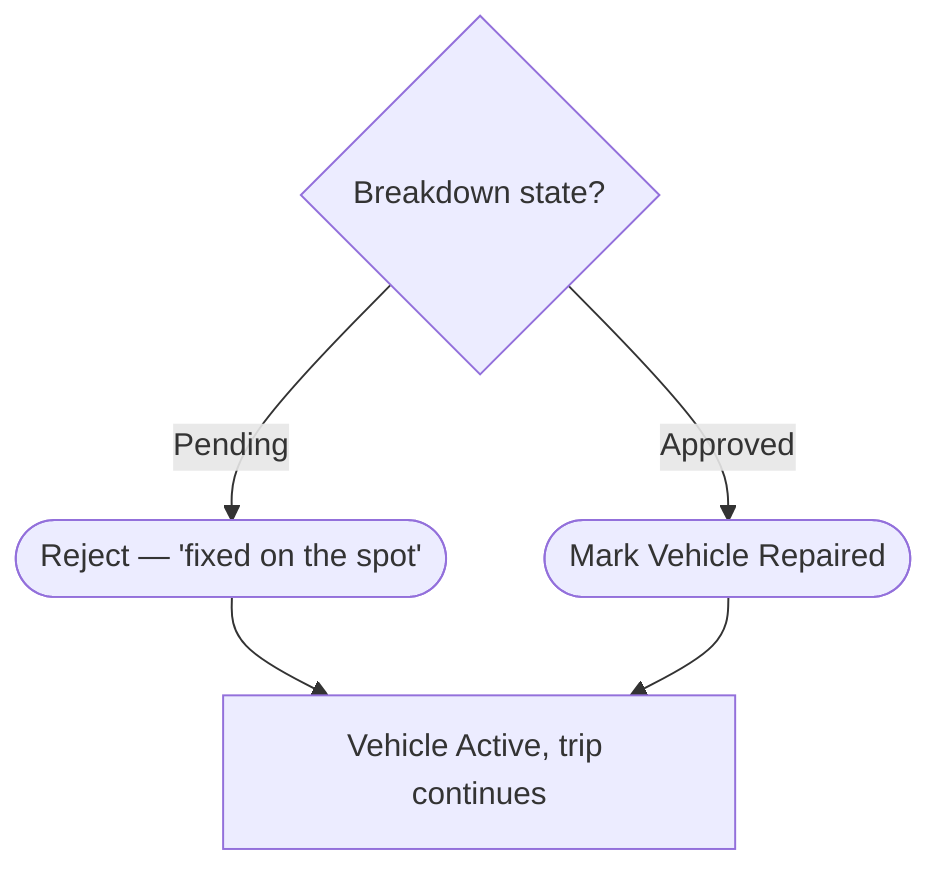

---

### S11 — The vehicle won't start in the morning, before the trip

**Steps**

1. **P1**: choose today's **Scheduled** trip as the **Trip Assignment**.
2. **P2**: all its stops move to the replacement trip; tick the vehicle's
   other trips and the upcoming-days plans as in **S3/S4**.

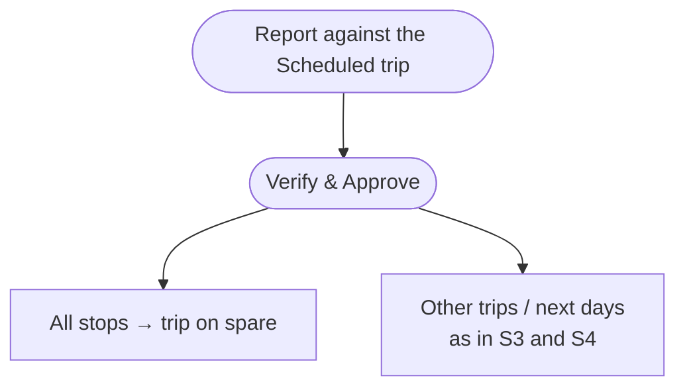

---

### S12 — Breaks down on a rest day, with no trip ⏸ *not available yet*

A breakdown needs a trip today. **Workaround:** none in the UI; report it on
the vehicle's next trip. *(Planned: "Report breakdown" on the vehicle master.)*

---

### S13 — One vehicle used by two plans (morning and afternoon)

**Steps**

1. **P2**: **Use \<spare\> for upcoming days** lists **both** plans.
2. Tick both (one spare for both, if the times allow), or tick one and set a
   different vehicle for the other with **P5**.

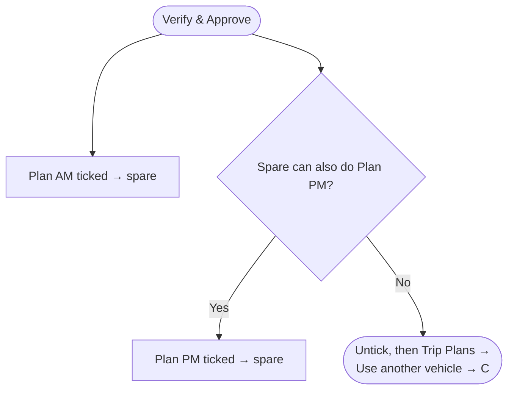

---

### S14 — Long breakdown / vehicle written off ⏸ *partly*

**Today:** **Schedule Setup → Trip Plans → Edit** the plan and change its
**Vehicle** to the replacement → Save. The temporary arrangement ends
automatically (see S15). *(Planned: a one-click "Make permanent".)*

---

### S15 — The plan's vehicle is edited while a replacement is in use

**Steps:** none extra. Editing the plan's **Vehicle** ends its
replacement-vehicle arrangement; the plan's new vehicle is used from the
next trip.

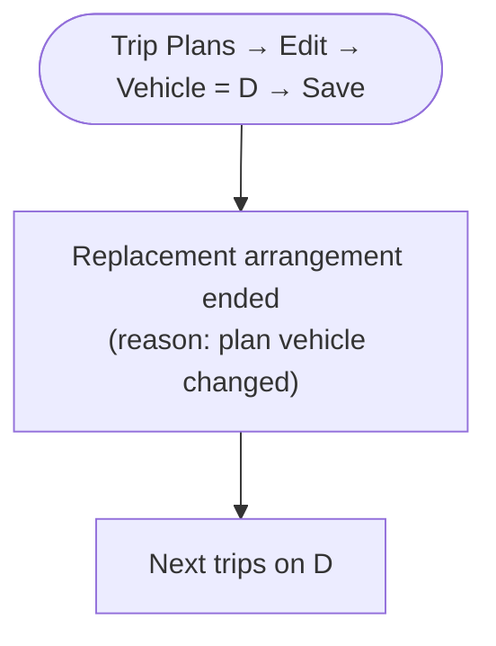

---

### Other cases

| Case | What happens / what to do |
|---|---|
| Two breakdowns on the same vehicle | Stays **Breakdown** until **both** are closed. |
| Pending breakdown deleted | Vehicle back to **Active** (if nothing else open). |
| Driver presses **Start** on a blocked trip | Refused: *"This vehicle is under breakdown. Contact your supervisor."* → supervisor does **P4** or **P7**. |
| Web: status changed to **In Progress** on a blocked trip | Refused with the same reason. |
| **New Daily Trip Plan** for a plan whose vehicle is broken | Uses the plan's replacement vehicle if one is set; otherwise refused: *"Set a replacement vehicle on the trip plan, or mark it repaired first."* |
| **Close & Start Next Trip** (re-trip) on a broken vehicle | Refused — use the breakdown replacement instead. |
| Approval from the **mobile app** | Same crew if none picked; **no** other trips moved (they stay tagged for **P4**); upcoming days set for plans where the spare has **no** clash. |
| Daily trip deleted | Its breakdown stays, so it can still be rejected or repaired; the vehicle is never stuck. |

---

## 5. Worked example

Vehicle **A** runs plan **Ward 5** every day: Trip 1 06:00, Trip 2 11:00,
Trip 3 14:00. Spare **B** has its own trip at 14:00 on Tuesday.

| When | What happens | Who does what |
|---|---|---|
| Tue 08:00 | A breaks down on Trip 1 → A **Breakdown** | Driver reports in the app |
| Tue 08:15 | Supervisor opens **Verify & Approve**: Trip 2 ticked, Trip 3 **unticked** (⚠ B busy at 14:00), Ward 5 "upcoming days" ticked | Supervisor approves |
| Tue 08:16 | Trip 1 stops → new trip on B; Trip 2 → B; Ward 5 runs on B from Wed | System |
| Tue 08:20 | Trip 3: **Daily Trip Plan → ⋮ Change Vehicle → C** | Supervisor |
| Wed | Scheduler: Ward 5 trips on **B**, same crew | System |
| Thu 10:00 | Mechanic done → **Mark Vehicle Repaired** → A **Active**, arrangement ended. Thursday's trips stay on B | Supervisor |
| Fri | Scheduler: Ward 5 back on **A** | System |

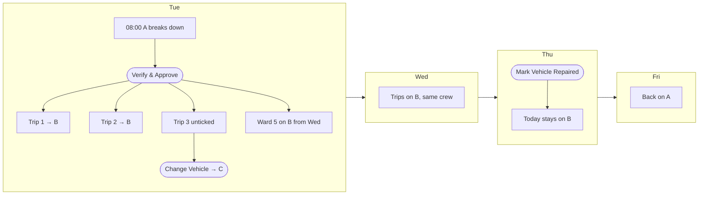

---

## 6. Behind the screens

### Vehicle status

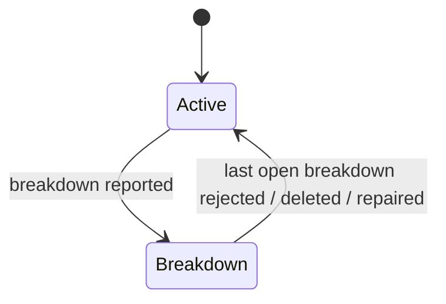

Recalculated from the breakdown rows every time one changes:
**Breakdown** if any breakdown is *not deleted, not rejected and not
repaired*; otherwise **Active**.

### Breakdown record

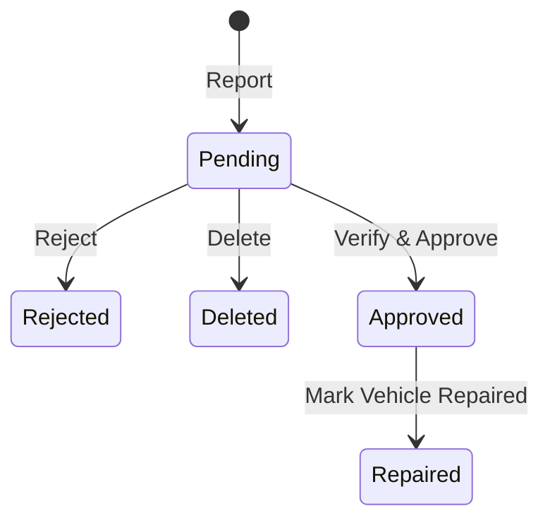

### Daily trip generation

Same rule for the nightly job, **Run Scheduler**, **Generate Daily**,
"generate selected plans" (mobile) and **New Daily Trip Plan**.

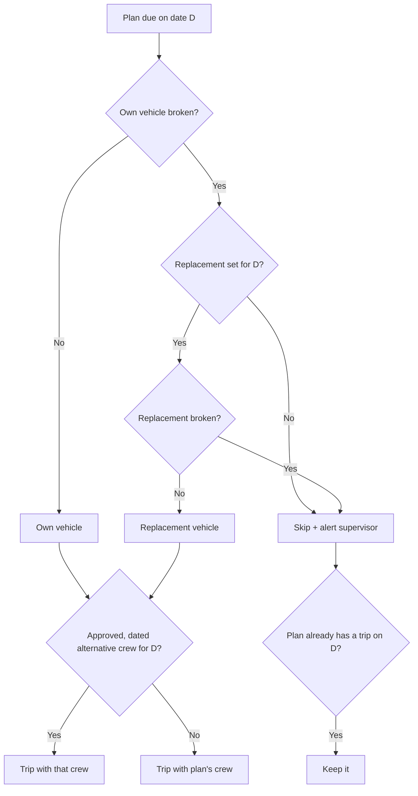

### Starting a trip

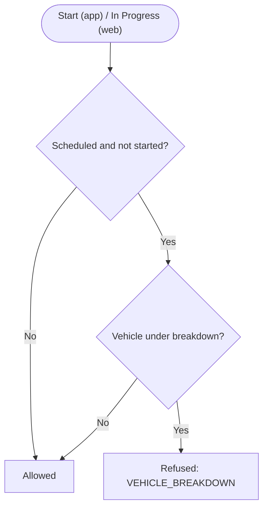

### Where it is stored

| Table / field | Holds |
|---|---|
| `VehicleCreation.operational_status` | `ACTIVE` / `BREAKDOWN` |
| `VehicleBreakdown.status` / `approval_status` | `REPORTED` / `REPLACEMENT_ARRANGED` / `REJECTED`; `PENDING` / `APPROVED` / `REJECTED` |
| `VehicleBreakdown.repaired_at`, `repaired_by`, `repair_remarks` | Mark Vehicle Repaired |
| `VehicleBreakdown.new_assignment`, `moved_assignment_ids` | Continuation trip; other trips moved at approval |
| `TripPlanVehicleSubstitution` | Plan, original vehicle, replacement vehicle, breakdown, `from_date`, `to_date` (empty = until repaired), `status` ACTIVE/ENDED, `end_reason` |
| `StaffNotification` `TRIP_NOT_SCHEDULED` | "Trip not created" alert |

---

## 7. API reference

Base `/api/v1`.

| Method | Path | Used by |
|---|---|---|
| POST | `/schedule-operations/vehicle-breakdowns/` | Report Breakdown |
| GET | `/schedule-operations/vehicle-breakdowns/available-vehicles/?date=` | Replacement Vehicle list |
| GET | `/schedule-operations/vehicle-breakdowns/available-staff-templates/?date=&trip_assignment_id=` | Replacement Staff Template list (includes the trip's own crew) |
| GET | `/schedule-operations/vehicle-breakdowns/{id}/verify-preview/` | Verify dialog: trips, plans, clashes, original crew |
| PATCH | `/schedule-operations/vehicle-breakdowns/{id}/verify/` | Approve: `move_assignment_ids`, `substitute_plan_ids`, `collection_point_ids`, `remarks`, replacement ids. Returns `skipped_moves`, `substituted_plan_ids` |
| PATCH | `/schedule-operations/vehicle-breakdowns/{id}/reject/` | Reject |
| PATCH | `/schedule-operations/vehicle-breakdowns/{id}/mark-repaired/` | Mark Vehicle Repaired |
| PATCH | `/schedule-operations/daily-trip-assignments/{id}/change-vehicle/` | Change Vehicle |
| GET | `/schedule-setup/trip-plans/{id}/vehicle-substitution-check/` | Clash check |
| POST | `/schedule-setup/trip-plans/{id}/vehicle-substitution/` | Use another vehicle (409 + `clashes` until `confirm_clashes`) |
| POST | `/schedule-setup/trip-plans/{id}/vehicle-substitution/end/` | Stop using replacement |
| POST | `/operator-mobile/trip-lifecycle/{id}/start/` | 409 `VEHICLE_BREAKDOWN` |

Verify defaults when a field is **omitted** (mobile app): same crew; **no**
other trips moved; upcoming days for every plan **without** a clash.

---

## 8. Not covered / known gaps

| Gap | Note |
|---|---|
| S12, S14 one-click | See those scenarios. |
| Mobile app UI | Needs: Mark Repaired button; handle `VEHICLE_BREAKDOWN` on Start (`vehicle.operational_status` can disable the button); show `TRIP_NOT_SCHEDULED` notifications; trip pickers on approval. |
| Crews of moved trips | Not notified about their new vehicle. |
| Time clashes | Trips have no end time: a hard clash is the **same date and time**; anything else is a warning. |
| Run Scheduler result | Shows the skipped count, not which plans were skipped for a breakdown. |
| Admin / summary dashboards | Count only pending breakdowns as open. |
| Trip plan form | Still lists broken vehicles in the Vehicle dropdown. |
| Cascade delete (existing bug) | Deleting a daily trip or trip plan doesn't soft-delete children linked by trip code (breakdowns, bin collection events, waste collections, logs). Not changed. |

---

## 9. Code map and tests

| File | Role |
|---|---|
| `app/models/masters/transport_masters/vehicleCreation.py` | `operational_status` |
| `app/models/core_modules/daily_operations/vehicle_breakdown.py` | Repair fields, `sync_vehicle_operational_status` |
| `app/models/core_modules/schedule_setup/trip_plan_vehicle_substitution.py` | Replacement-vehicle arrangement |
| `app/services/vehicle_substitution.py` | `vehicle_for_plan`, alternative crew, clashes, `verify_preview`, alert |
| `app/serializers/core_modules/daily_operations/vehicle_breakdown_serializer.py` | Verify / Reject / Mark Repaired |
| `app/management/commands/generate_daily_trips.py` | `run_for_date` (nightly, Run Scheduler, Generate Daily) |
| `app/services/daily_trip_generation.py` | Generate selected |
| `app/viewsets/core_modules/daily_operations/vehicle_breakdown_viewset.py` | Breakdown actions, available vehicles / crews, verify-preview |
| `app/viewsets/core_modules/daily_operations/daily_trip_assignment_viewset.py` | Start block, Change Vehicle |
| `app/viewsets/core_modules/schedule_setup/trip_plan_viewset.py` | Use another vehicle / stop |
| `app/viewsets/operator_mobile/trip_lifecycle_viewset.py` | App Start block |
| Migrations `0006`–`0008` | Status + repair fields (with backfill), moved trips, substitutions |

Tests: `tests/schedule_setup/test_vehicle_substitution.py` (one test per
scenario), `test_vehicle_breakdown_status.py`, `test_vehicle_breakdown_options.py`.
