# Re-Trip: Scenarios, UI Steps and Flows

What happens when a trip has to end while stops are still left: the truck
is full, the shift is over, or a road is blocked. This covers how a Re-Trip
is requested, approved, rejected or lapses, what moves to the next trip,
and exactly what the supervisor and the driver do on screen for each
situation.

> Flow charts are [Mermaid](https://mermaid.js.org/). GitHub renders them
> directly; in VS Code install **Markdown Preview Mermaid Support**.

**Contents**

1. [Rules at a glance](#1-rules-at-a-glance)
2. [Screens used](#2-screens-used)
3. [The basic procedures (P1–P6)](#3-the-basic-procedures)
4. [Scenarios S1–S18 with steps and flow charts](#4-scenarios)
5. [Worked example over one day](#5-worked-example)
6. [Behind the screens: states, timers, carry-over and locking](#6-behind-the-screens)
7. [API reference](#7-api-reference)
8. [Not covered / known gaps](#8-not-covered--known-gaps)
9. [Code map and tests](#9-code-map-and-tests)

---

## 1. Rules at a glance

| Rule | Behaviour |
|---|---|
| Why it exists | A trip with stops left can't be closed normally: nothing auto-closes it, and a **Skipped** stop never counts as resolved. Re-Trip is the controlled way out. |
| Who asks | The **driver/operator** (app: **End Trip** with stops left), or a **supervisor/admin** on the web (**Raise Re-Trip Request**, or the one-step **Close & Start Next Trip**). |
| Which trips | Only an **In Progress** trip. A trip that never started can't be cut short; one with nothing left just ends normally. |
| Reason | Required. Pick a category: **Vehicle full, Shift ending, Road blocked, Going for weighment, Other**. **Other** needs at least **10 characters** of explanation. |
| One at a time | At most **one Pending** request per trip. |
| While Pending | The trip **stays In Progress**. The driver can keep collecting; the supervisor's screen always shows the **live** list of stops left. |
| Who decides | The trip plan's **supervisor**, a user with **edit** permission on Re-Trip Requests **in the same company/project**, or a platform superadmin. |
| Decision window | **30 minutes**, and never past **midnight after the trip's date**. Reminder at **10 min**, escalation at **20 min**. Undecided → **Expired**; the trip stays open. |
| Approve | The old trip is **Completed**. A **new trip** (same plan, vehicle, crew and date, starting now) gets the **ticked** stops. **Unticked** stops are marked **Missed**. |
| Reject | Nothing changes; the crew is told to continue. |
| Carried stops | Stay **Pending** on the old trip, marked as carried to the new one. They no longer count as the old trip's work and can't be scanned there. |
| Vehicle breakdown | A broken vehicle can't Re-Trip. Use the breakdown replacement; it closes any pending Re-Trip request. |
| End of day | A request undecided at midnight lapses. A next trip nobody started on its day is **Cancelled** by the end-of-day closer and its stops marked **Missed**. |

---

## 2. Screens used

| Menu | Screen | Used for |
|---|---|---|
| **Schedule Operations → Re-Trip Requests** | Request list | Review requests; **Raise Re-Trip Request**; row actions **✓ Re-Trip (Approve)** and **✕ Reject**. Opens filtered to **Pending**. |
| Same menu → **Raise Re-Trip Request** | Form | Raise a Pending request on the crew's behalf. |
| **Daily Operations → Daily Trip Plan** | Daily trips | Column **Re-Trip** (status of the trip's request); row **⋮ → Close & Start Next Trip** (In Progress trips only). |
| Driver / operator mobile app | Trip screen | **End Trip** with stops left → reason → request sent. Shows the pending request and its deadline. |
| Supervisor mobile app | Notifications / requests | "Re-Trip requested", reminders, escalation; list of requests for the plans the supervisor owns. |

Columns on the **Re-Trip Requests** list: Request ID, Trip, Area, Vehicle,
Type (bin / household), Pending Stops, Reason, Requested By, **Decision
Window** (time left; orange in the last 10 minutes, red when Expired),
Status, Actions.

Row actions:

| Request state | Actions shown |
|---|---|
| Pending, inside its window | **✓ Re-Trip (Approve)**, **✕ Reject** (needs edit permission) |
| Pending but past its window, Approved, Rejected, Expired | none |

**Re-Trip** column on the Daily Trip Plan:

| Badge | Meaning |
|---|---|
| **⚠ Pending** + "Decision due HH:MM" | Waiting for a supervisor |
| **→ Proceeded** + "Next: TRIP-…" | Approved; the next trip's ID |
| **✕ Rejected** | Declined; trip continues |
| **Expired** | Lapsed without a decision |

---

## 3. The basic procedures

Every scenario in section 4 is a combination of these procedures.

### P1 — Driver requests a Re-Trip (mobile app)

1. On the running trip, press **End Trip**.
2. If **every** stop is done, the trip simply ends. Otherwise the app asks
   for a reason and shows how many bin/household stops are left.
3. Pick the **reason** (or type it, on older app builds) → send.

Result: request **Pending**; trip stays **In Progress**; the plan's
supervisor gets **"Re-Trip requested"** with the stop count and reason.

### P2 — Raise a request from the web (on the crew's behalf)

Use when the driver phoned the control room or has no network.

1. **Re-Trip Requests → Raise Re-Trip Request**.
2. **Scope**: choose **Company** (superadmin only) and **Project**.
3. **Trip Assignment**: today's open trips. **Vehicle, Driver, Operator**
   fill in automatically, and **Pending stops** previews what would carry over.
4. **Reason**: pick a category. **Details** is optional, except for **Other**,
   where at least 10 characters are required.
5. **Raise Request**.

Result: exactly as **P1**. The supervisor reviews it like a driver's request.

### P3 — Approve

1. **Re-Trip Requests** → row **✓ Re-Trip (Approve)**.
2. The dialog lists the **live** pending stops, **all ticked**. Untick any stop
   that should **not** go to the next trip. At least one must stay ticked.
3. Optional remarks → **Approve Re-Trip**.

Result:

- Old trip → **Completed**.
- New trip on the same plan, vehicle, crew and date, scheduled **now**,
  with the ticked stops.
- Unticked stops → **Missed** ("Not carried over in Re-Trip …").
- The crew gets **"Re-Trip approved"** with the new trip ID and stop count
  and must press **Start** on it.

Refused if the window has passed, the trip was already closed another way,
or the vehicle is under breakdown.

### P4 — Reject

1. Row **✕ Reject** → optional message for the driver → **Reject**.

Result: request **Rejected**; trip stays **In Progress**; the crew gets
**"Re-Trip declined"** ("Please continue the remaining stops" or your
message).

### P5 — Close & Start Next Trip (one step, web)

For a supervisor who already knows the trip must end (e.g. going for
weighment). There's no request/approve round trip.

1. **Daily Trip Plan** → In Progress trip → **⋮ → Close & Start Next Trip**.
2. **Reason** (+ details; required for Other).
3. Bin trip: tick the **Stops to carry over**. Household trip: every
   remaining household carries over.
4. Confirm.

Result: same as **P3**. If the driver already had a Pending request on
that trip, **that** request is approved (keeping the driver's reason) and no
second one is created. Only supervisors/admins see this action.

### P6 — Let it lapse / ask again

If nobody decides in time the request becomes **Expired**. The trip is still
open: the driver continues, or raises a new request (**P1**/**P2**).

---

## 4. Scenarios

Legend for flow charts: rounded = a person's action on screen, rectangle =
what the system does, diamond = decision.

### S1 — Truck is full mid-route; supervisor approves everything *(main case)*

**Situation:** 10:30, bin trip, 14 of 20 stops done, truck full.

**Steps**

1. Driver: **P1**, reason **Vehicle full**.
2. Supervisor: **P3**, leave all 6 stops ticked → **Approve Re-Trip**.
3. Driver: after unloading, opens the new trip and presses **Start**.

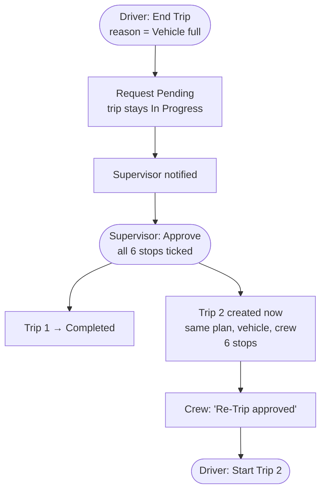

---

### S2 — Only some stops should go to the next trip

**Situation:** 6 stops left; two are in a market that is already closed for
the day.

**Steps**

1. **P3**: untick the two market stops → **Approve Re-Trip**.
2. The dialog warns: *"2 unselected stop(s) will be marked missed."*

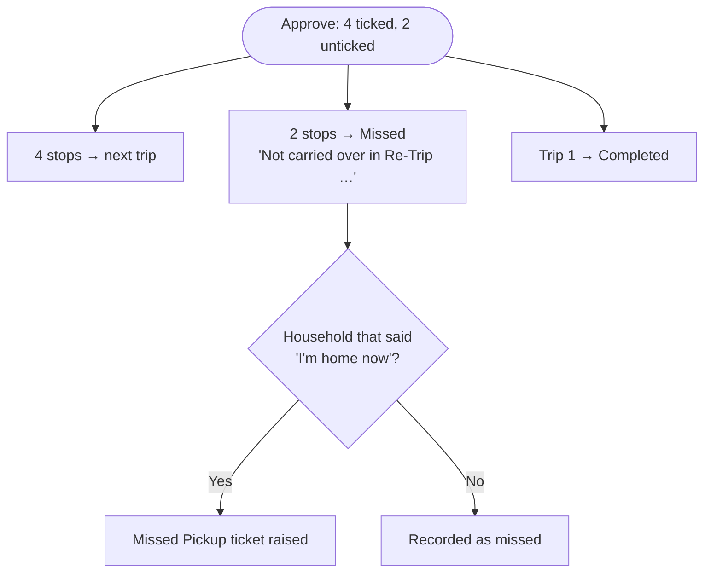

Unticked stops are never left Pending on the closed trip; they are on record
as missed.

---

### S3 — Supervisor says no

**Situation:** only 2 stops left, both close by.

**Steps**

1. **P4** with a message, e.g. "Only two left, finish them first."

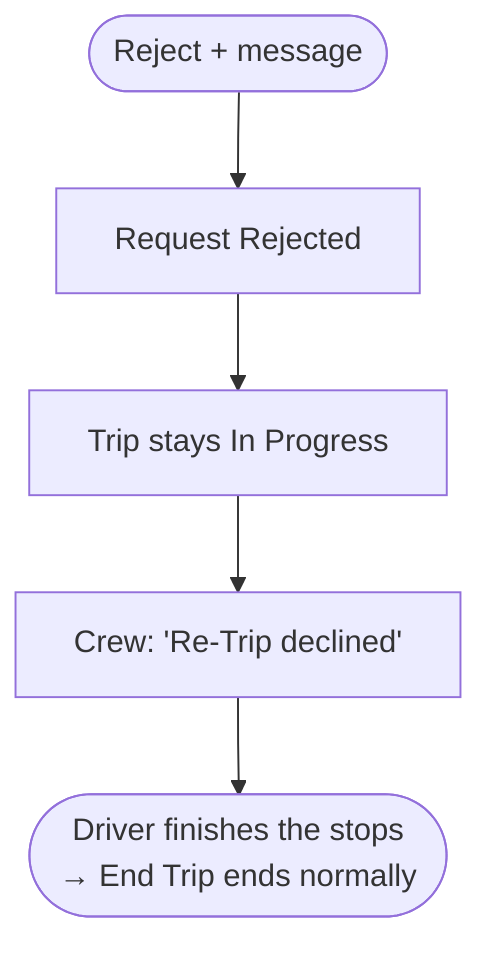

---

### S4 — Nobody decides in time

**Situation:** supervisor is busy and the request sits.

**What happens (automatically)**

| After | System does |
|---|---|
| 0 min | Supervisor: "Re-Trip requested" |
| 10 min | Supervisor: **"Re-Trip decision reminder"** |
| 20 min | Supervisor: **"Urgent Re-Trip decision"** with minutes left |
| 30 min | Request **Expired**. Supervisor and crew: "Re-Trip request expired. The trip remains open." Approve/Reject buttons disappear. |

**Steps after expiry:** driver continues, or asks again (**P6**).

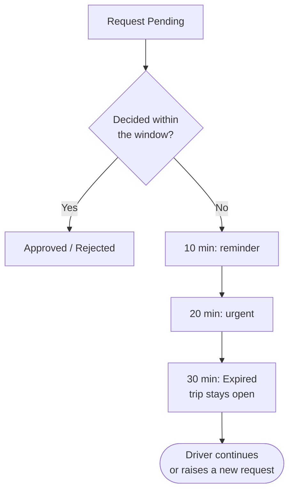

Times are configurable: `RETRIP_EXPIRY_MINUTES` (30),
`RETRIP_REMINDER_MINUTES` (10), `RETRIP_ESCALATION_MINUTES` (20).

---

### S5 — Driver keeps collecting while the request is pending

**Situation:** request raised with 6 stops left; the driver collects 2 more
before the supervisor opens it.

**Steps:** none extra. The approve dialog shows the **live** 4 stops, not the
original 6. The request keeps the original 6 as an audit snapshot.

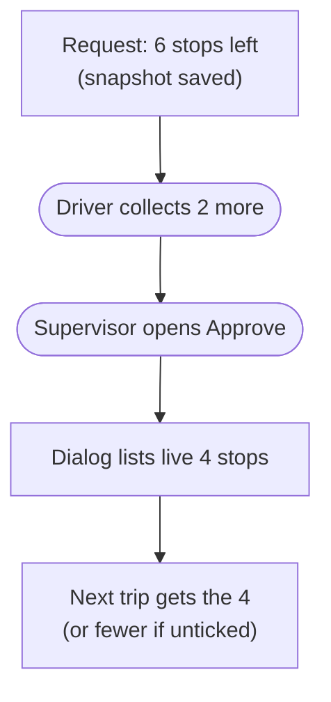

If a scan lands at the **same moment** as the approval, the two are queued:
either the stop is collected first and not carried, or it is carried first
and the scan is refused (see **S14**). It is never both.

---

### S6 — Supervisor uses Close & Start Next Trip while the driver's request is waiting

**Situation:** driver raised a request; the supervisor, on the Daily Trip
Plan screen, uses **⋮ → Close & Start Next Trip** instead of the request
list.

**Steps:** **P5** as normal.

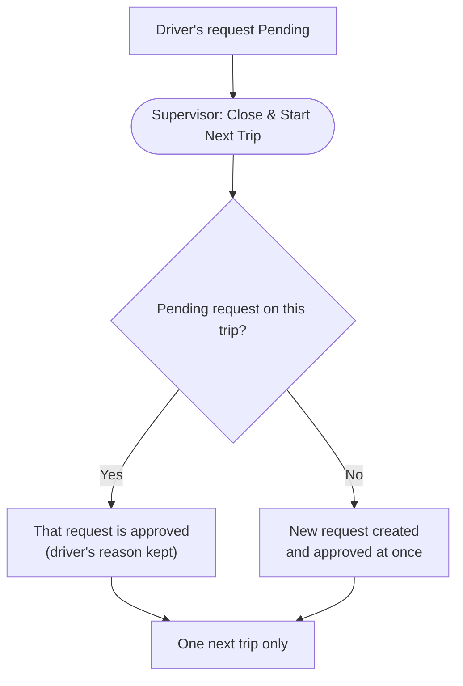

The driver's request is approved, not left behind. A leftover Pending
request could otherwise be approved later and copy the same stops into a
**second** next trip.

---

### S7 — Raising the request for the crew from the web

**Situation:** driver calls the control room; the phone has no data.

**Steps**

1. **P2** (pick the trip, check the pending stops, reason).
2. Then **P3**/**P4** as for any request. The supervisor sees the web user
   as **Requested By**.

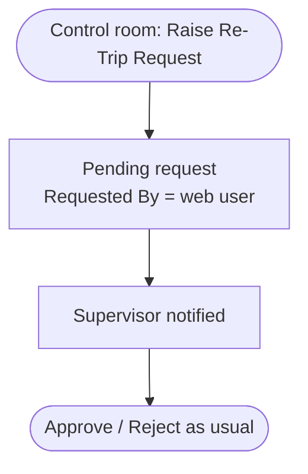

---

### S8 — Two requests at the same moment

**Situation:** the driver double-taps on a weak network, or the driver and
the control room raise one at the same second.

**What happens:** only **one** request is created. The second gets
*"A Re-Trip request for this trip is already awaiting approval."* (app code
`RETRIP_PENDING`; the app shows the existing request).

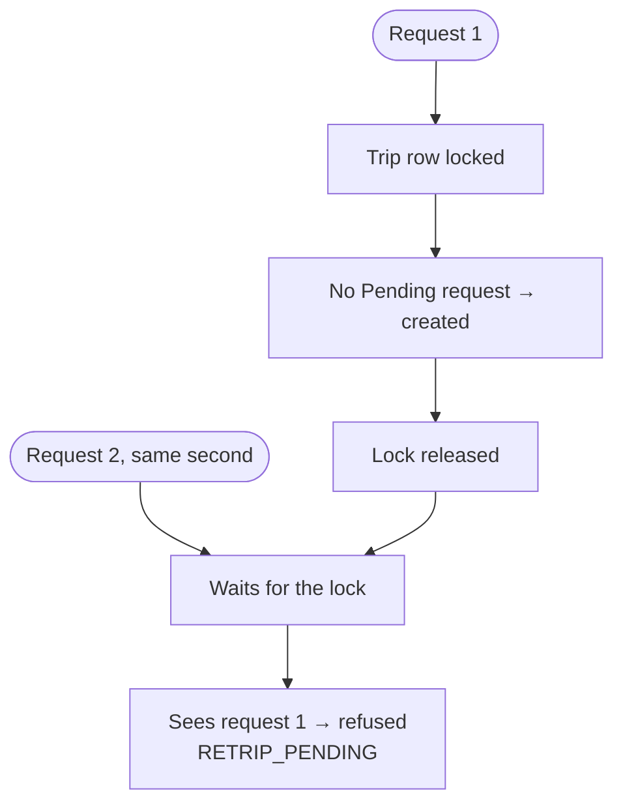

---

### S9 — The vehicle breaks down while a Re-Trip request is pending

**Situation:** truck full → Re-Trip requested → then the engine fails.

**Steps**

1. Report the breakdown and **Verify & Approve** it (see
   [11-vehicle-breakdown.md](11-vehicle-breakdown.md)).
2. The pending Re-Trip request is closed automatically as **Rejected**:
   *"Superseded: trip closed by vehicle breakdown replacement (TRIP-…)."*

Approving the Re-Trip itself is refused while the vehicle is under
breakdown: *"Use the vehicle breakdown replacement instead of a re-trip."*

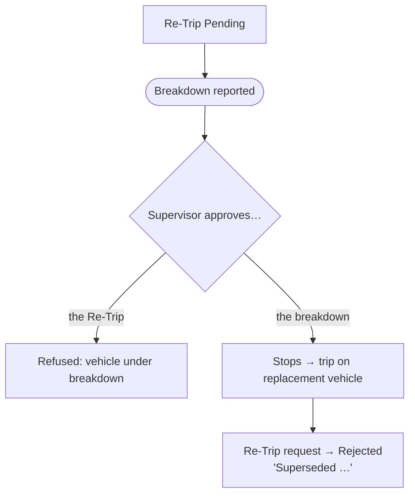

---

### S10 — Trying to cut short a trip that never started

**Situation:** the driver presses End on a **Scheduled** trip, or someone
tries it from the web.

**What happens:** refused. App code `TRIP_NOT_STARTED`: *"This trip has not
started yet, so it cannot be cut short."* Without this rule the trip would
show as a zero-minute "Completed" trip and all its work would silently move
to a new one.

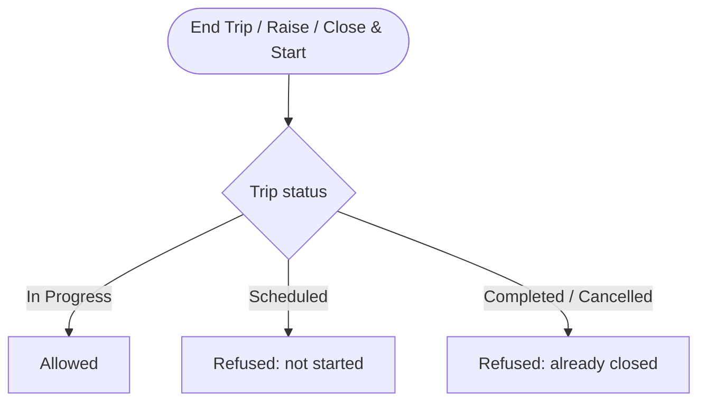

---

### S11 — Nothing is left

**Situation:** the driver presses **End Trip** after the last stop.

**What happens:** the trip ends at once; no request. On the web form the
trip shows *"Every stop on this trip is done — no Re-Trip is needed"* and the
button is disabled.

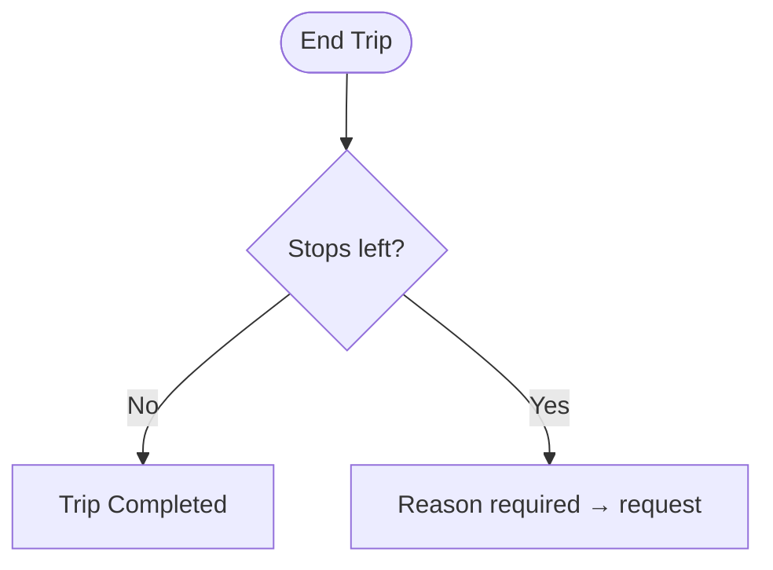

---

### S12 — The day ends before anyone decides

**Situation:** request raised at 23:45; nobody looks until 00:10.

**What happens:** the window ends at **midnight**, earlier than the
30 minutes. The request becomes **Expired** ("the trip's day ended before a
supervisor decision"), and the approve button disappears. The next
end-of-day run closes yesterday's trip and marks its open stops **Missed**.

Why: a next trip created after midnight would carry *yesterday's* date. It
would never appear on the crew's "today" list, and its stops would be lost.

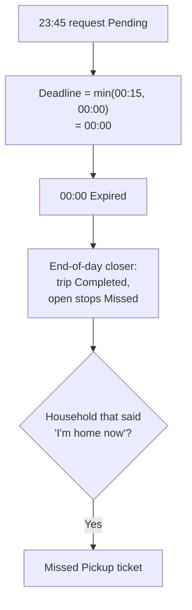

---

### S13 — The next trip is never started on its day

**Situation:** Re-Trip approved at 17:50; the crew goes home without starting
the new trip.

**What happens:** at the next end-of-day run, the closer finds the
never-started next trip from a past day. It marks its stops **Missed**
("the next trip carrying this stop was never started on its day") and sets
the trip to **Cancelled** with a remark. Ordinary Scheduled trips that
never started are left alone; only Re-Trip and breakdown next trips are
handled this way.

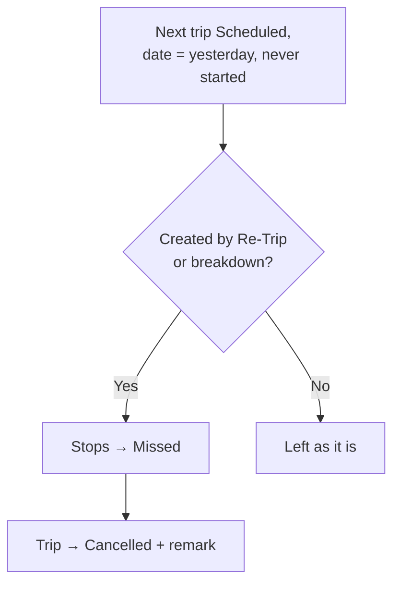

---

### S14 — The driver's app still shows the old trip after approval

**Situation:** approval happened, but the app hasn't refreshed. The driver
scans a bin, or marks a household, on the **old** trip.

**What happens:** refused. The driver is asked to refresh:

| Code | Message |
|---|---|
| `TRIP_CLOSED` | "This trip has ended. Refresh your trip list." |
| `STOP_CARRIED_OVER` | "This stop moved to your next trip (TRIP-…). Refresh your trip list." |

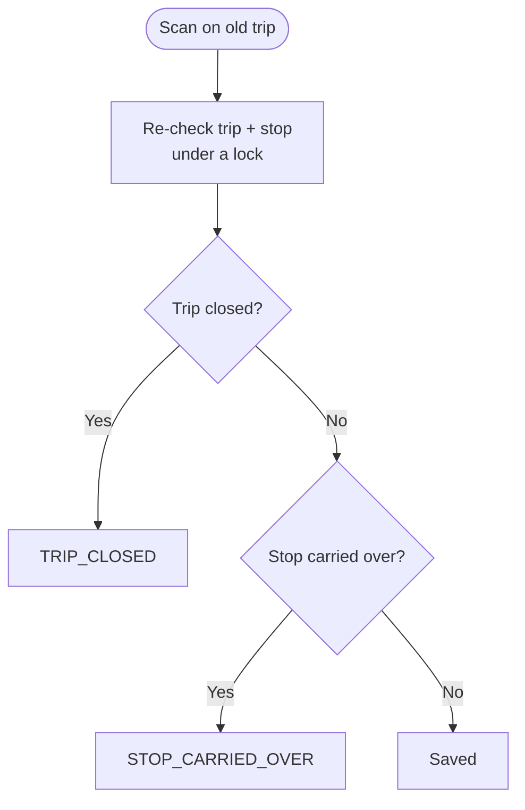

Without this, the old row would be marked collected while the new trip's
copy stayed Pending, and the crew would visit the stop twice.

---

### S15 — A second Re-Trip on the same day

**Situation:** Trip 2 (the next trip) also fills up.

**Steps:** same as **S1**, on Trip 2. The Daily Trip Plan shows the chain
as trip 1, 2, 3 … for that plan and date (`trip_count`).

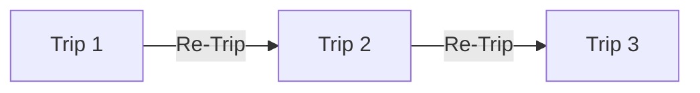

There is no limit on the chain yet (see section 8).

---

### S16 — Household trip with a customer who said "I'm home now"

| Supervisor's choice | Result |
|---|---|
| Stop **ticked** | Carried to the next trip **with** the "customer available" flag, so the new crew sees it. A miss there still raises the ticket. |
| Stop **unticked** | Marked **Not Available**, and a **Missed Pickup** ticket is raised for the customer. |

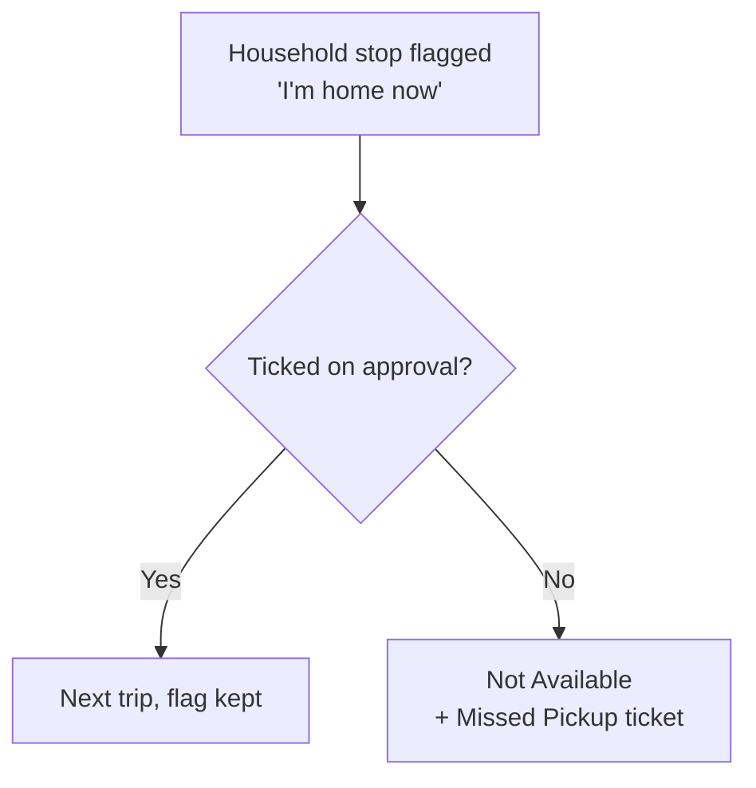

---

### S17 — The timer job isn't running

**Situation:** the in-app scheduler is disabled
(`ENABLE_DAILY_TRIP_JOB_SCHEDULER=false`) or crashed, so reminders and
expiry don't fire.

**What happens:**

- Any approve, reject, new request or End Trip on that trip still checks the
  deadline itself, so an overdue request can't be approved.
- The **end-of-day closer** expires overdue requests before deciding whether
  a past-day trip is "waiting for a decision". A forgotten request can no
  longer keep a trip open for ever.
- Only the **reminder/escalation notifications** are lost. Run
  `python manage.py process_retrip_timeouts` from cron if the scheduler is off.

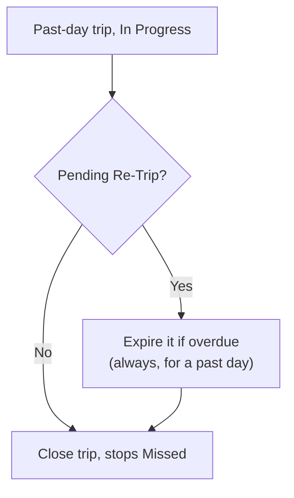

---

### S18 — Someone from another company tries to decide

**Situation:** an admin of Company A has edit permission on Re-Trip
Requests and tries to approve a Company B request by its ID.

**What happens:** **403 — "You do not supervise this trip plan."** Edit
permission only works inside the user's own company/project. The trip
plan's supervisor can always decide, even across projects.

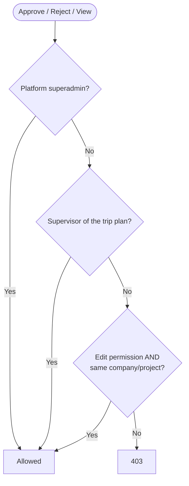

---

### Other cases

| Case | What happens / what to do |
|---|---|
| Reason "." or "ok" | Refused: *"Describe the reason in at least 10 characters."* Pick a category instead, or explain. |
| Unknown reason code | Refused: *"Choose a valid reason."* |
| Approve after the window | Refused: *"This request expired before it could be approved."* The list reloads. |
| Approve a request already decided | Refused (409): *"This request was already approved / rejected / expired."* |
| Approve with no stop ticked | Button disabled. The API refuses an empty carry-over. |
| Selected stop no longer pending (collected meanwhile) | Refused: *"Selected stop is not pending on this trip."* Reopen the dialog. |
| Re-Trip on a vehicle under breakdown | Refused; use the breakdown replacement (**S9**). |
| Request on a trip from another project | The web form only lists trips in the chosen company/project. |
| Request rows | Read-only: they can't be edited or deleted, only decided. |

---

## 5. Worked example

Plan **Ward 5 Wet**, vehicle **TN01AB1234**, driver **Ravi**, supervisor
**Meena**. 20 bin stops.

| When | What happens | Who does what |
|---|---|---|
| 06:00 | Trip 1 started | Ravi |
| 10:30 | 14 done, truck full → **End Trip**, reason **Vehicle full** → request Pending (6 left) | Ravi |
| 10:31 | "Re-Trip requested: 6 stop(s) left. Reason: Vehicle full" | System → Meena |
| 10:38 | Ravi collects 1 more on the way to unload (5 left) | Ravi |
| 10:41 | "Re-Trip decision reminder" | System → Meena |
| 10:45 | Meena opens **Approve**: live list shows **5**. Unticks the closed market stop → **Approve Re-Trip** | Meena |
| 10:45 | Trip 1 **Completed**; Trip 2 created with **4** stops; market stop **Missed** | System |
| 10:45 | "Re-Trip approved: TRIP-…-002 with 4 stop(s)" | System → Ravi |
| 11:30 | Back from unloading → **Start** Trip 2 | Ravi |
| 11:32 | Stale phone tries a scan on Trip 1 → `TRIP_CLOSED`, refreshes | Ravi |
| 12:40 | Trip 2 done → **End Trip** ends normally | Ravi |

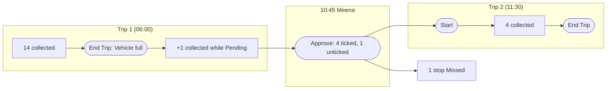

---

## 6. Behind the screens

### Request states

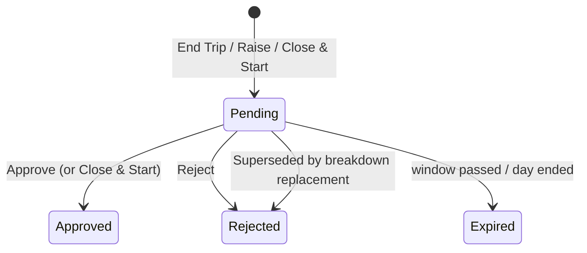

### What approval does to the trips

```mermaid
flowchart TD
    A["Approve"] --> L["Lock: trip → request → stops"]
    L --> C1{"Request still Pending<br/>and inside its window?"}
    C1 -- No --> X1["Refused / Expired"]
    C1 -- Yes --> C2{"Trip still open?"}
    C2 -- No --> X2["Refused: already closed"]
    C2 -- Yes --> C3{"Vehicle under breakdown?"}
    C3 -- Yes --> X3["Refused: use breakdown"]
    C3 -- No --> S["Read LIVE pending stops"]
    S --> N["Create next trip<br/>(same plan, vehicle, crew, date;<br/>Scheduled; time = now)"]
    N --> CP["Copy ticked stops as Pending"]
    CP --> MK["Old rows: carried_to = next trip"]
    MK --> MS["Unticked: Missed (+ tickets)"]
    MS --> E["Old trip → Completed"]
    E --> R["Request → Approved<br/>new_assignment_id set"]
    R --> NT["Crew notified"]
```

### Trip status around a Re-Trip

```mermaid
stateDiagram-v2
    [*] --> Scheduled
    Scheduled --> InProgress: Start
    InProgress --> InProgress: Re-Trip Pending / Rejected / Expired
    InProgress --> Completed: Re-Trip approved
    state "Next trip" as Next {
        [*] --> NScheduled
        NScheduled --> NInProgress: Start
        NScheduled --> Cancelled: never started on its day
        NInProgress --> NCompleted: End Trip
    }
    Completed --> Next: created on approval
```

### Timers

| Setting | Default | Effect |
|---|---|---|
| `RETRIP_EXPIRY_MINUTES` | 30 | Decision window (cut short by midnight after the trip date) |
| `RETRIP_REMINDER_MINUTES` | 10 | First reminder to the supervisor |
| `RETRIP_ESCALATION_MINUTES` | 20 | "Urgent" notification |

The timers run inside the in-app scheduler loop, roughly once a minute
(`ENABLE_DAILY_TRIP_JOB_SCHEDULER`), or with
`python manage.py process_retrip_timeouts`. The end-of-day closer runs with
the daily trip job, or with `python manage.py close_stale_trips`. Each
reminder fires once, even with several API workers running.

### Reason rules

```mermaid
flowchart TD
    A["reason_code + text"] --> B{"Code given?"}
    B -- No --> O["Treated as Other<br/>(older app builds)"]
    B -- Yes --> C{"Known code?"}
    C -- No --> X["Refused: choose a valid reason"]
    C -- Other --> O
    C -- "Listed category" --> L["Stored text = label<br/>or 'label: note'"]
    O --> M{"Text ≥ 10 characters?"}
    M -- No --> Y["Refused (REASON_REQUIRED)"]
    M -- Yes --> T["Stored text = the text"]
```

### Concurrency (why there are row locks)

Production runs **MySQL**, which ignores "unique only when Pending" database
constraints. So "one Pending request per trip" and "a scan can't race an
approval" are enforced with **row locks**, always taken in the same order
so they can't deadlock:

| Action | Locks, in order |
|---|---|
| Raise a request | trip → its requests |
| Approve | trip → request → pending stops |
| Breakdown replacement | trip → stops → requests |
| Bin scan / household Not Available or Collect Later | trip → stop |

### Where it is stored

| Table / field | Holds |
|---|---|
| `TripRetripRequest.status` | `Pending` / `Approved` / `Rejected` / `Expired` |
| `TripRetripRequest.reason_code`, `reason` | Category (empty on old rows) and readable text |
| `TripRetripRequest.pending_bin_count`, `pending_household_count`, `pending_snapshot` | What was left **when requested** (audit) |
| `TripRetripRequest.expires_at`, `reminder_sent_at`, `escalated_at` | Timer state |
| `TripRetripRequest.reviewed_by_id`, `reviewed_at`, `review_remarks` | Decision |
| `TripRetripRequest.new_assignment_id` | The next trip |
| `DailyTripCollectionPoint.carried_to_assignment`, `DailyTripHouseholdCollection.carried_to_assignment` | Old stop → the next trip that owns it |
| `StaffNotification` `RETRIP_REQUESTED / APPROVED / REJECTED / REMINDER / ESCALATED / EXPIRED` | Notifications |

---

## 7. API reference

Base `/api/v1`.

| Method | Path | Used by |
|---|---|---|
| GET | `/schedule-operations/retrip-requests/?status=Pending` | Request list (also `?mine=true` for a supervisor's own plans, `?assignment_id=`) |
| GET | `/schedule-operations/retrip-requests/{id}/` | Detail incl. `live_pending`, `time_remaining_seconds`, `urgency` |
| GET | `/schedule-operations/retrip-requests/reason-codes/` | Reason dropdown |
| GET | `/schedule-operations/retrip-requests/pending-stops/?assignment_id=` | Web form preview |
| POST | `/schedule-operations/retrip-requests/` | Raise: `{assignment_id, reason_code, reason}` → 201; 409 if one is pending; 400 for reason / trip state |
| POST | `/schedule-operations/retrip-requests/{id}/approve/` | `{collection_point_ids?, remarks?}` → `{request, new_assignment_id}`; 409 expired / decided / closed |
| POST | `/schedule-operations/retrip-requests/{id}/reject/` | `{remarks?}` |
| POST | `/schedule-operations/daily-trip-assignments/{id}/proceed-next-trip/` | Close & Start Next Trip: `{reason_code?, remarks?, collection_point_ids?}` (bin trips need ids) |
| POST | `/operator-mobile/trip-lifecycle/{id}/end/` | Driver End Trip: `{reason_code?, reason?}` |

Driver **End Trip** responses:

| Status / code | Meaning |
|---|---|
| 200 `ended: true` | Nothing left, trip closed |
| 201 `retrip_requested: true` | Request created (`retrip_request` in the body) |
| 400 `REASON_REQUIRED` | No / too short reason. Body has `pending_bin_count`, `pending_household_count`, `reason_codes` |
| 409 `RETRIP_PENDING` | One is already waiting (body has it) |
| 409 `TRIP_NOT_STARTED` / `TRIP_CLOSED` | Wrong trip state |

Scan / household endpoints may now return **409 `TRIP_CLOSED`** or
**`STOP_CARRIED_OVER`**. The app should refresh the trip list on these.

---

## 8. Not covered / known gaps

| Gap | Note |
|---|---|
| Escalation | "Escalated" goes to the **same** supervisor, not up the chain. A plan with no supervisor notifies nobody; its requests just expire. |
| Request cap | No limit on expire → ask again on one trip. |
| Self-approval | A web user can raise a request and approve it themselves (Close & Start Next Trip is the intended one-step path). |
| Chain limit | No limit on Trip 2, 3, 4 … on the same day. |
| Bin selection on approve API | Omitting `collection_point_ids` carries everything; Close & Start Next Trip requires a pick for bin trips. |
| Household crew check | Household endpoints accept an explicit `assignment_id` without checking the caller is on that trip's crew. |
| Household "collect" race | `finalize-waste` refuses closed trips and carried stops, but doesn't take the row lock, so a collect at the exact instant of approval could still slip through. |
| Mobile app | Should offer the reason picker (`reason_codes`) and refresh on `TRIP_CLOSED` / `STOP_CARRIED_OVER` / `TRIP_NOT_STARTED`. |
| Breakdown verify with empty `collection_point_ids: []` | Treated as "carry no bins"; those bins are marked Missed. |
| Tests | Run on SQLite, where row locks are no-ops; the race paths are logic-tested only. |

---

## 9. Code map and tests

| File | Role |
|---|---|
| `app/models/core_modules/daily_operations/trip_retrip_request.py` | Request model, statuses, reason codes |
| `app/models/core_modules/daily_operations/daily_trip_assignment.py` | `pending_bin_stops` / `pending_household_stops` (exclude carried stops), `trip_count` |
| `app/services/retrip_service.py` | `request_retrip`, `approve_retrip`, `reject_retrip`, `proceed_to_next_trip`, `create_breakdown_continuation`, `resolve_reason`, locking helpers |
| `app/services/retrip_timeout_service.py` | Deadline (window + day end), reminders, escalation, expiry |
| `app/services/stale_trip_closer.py` | End-of-day close; expires leftover requests; cancels never-started next trips |
| `app/services/daily_trip_scheduler.py` | Runs the timers about once a minute and the daily job |
| `app/viewsets/core_modules/daily_operations/trip_retrip_viewset.py` | List / raise / approve / reject / reason-codes; who may decide |
| `app/viewsets/core_modules/daily_operations/daily_trip_assignment_viewset.py` | `proceed-next-trip` |
| `app/viewsets/operator_mobile/trip_lifecycle_viewset.py` | Driver End Trip |
| `app/viewsets/operator_mobile/helpers.py` | `raise_if_stop_unwritable`, `lock_stop_for_write` |
| `app/viewsets/operator_mobile/scan_bin_viewset.py`, `app/viewsets/waste_collection_bluetooth/waste_bluetooth_viewset.py` | Driver write paths with the lock re-check |
| `app/serializers/core_modules/daily_operations/trip_retrip_serializer.py` | Live pending stops, time left, urgency, reason label |
| `app/management/commands/process_retrip_timeouts.py`, `close_stale_trips.py` | Manual / cron runs |
| Migration `0009_tripretriprequest_reason_code` | Reason category |
| Frontend `dailyOperations/tripRetripRequest/` | List, approve/reject dialogs, Raise form, reason options |
| Frontend `dailyOperations/dailyTripAssignment/dailyTripAssignmentList.tsx` | Re-Trip column, Close & Start Next Trip dialog |

Tests:

- `tests/schedule_setup/test_retrip_loopholes.py`: one block per scenario: duplicates, races, cross-company, unselected stops, day end, never started, stale app.
- `test_retrip_web_create.py`: Raise form and reason rules.
- `test_retrip_continuation.py`: carry-over copying.
- `test_retrip_timeouts.py`: reminders and expiry.
- `tests/test_stale_trip_closer.py`: end-of-day closer.
