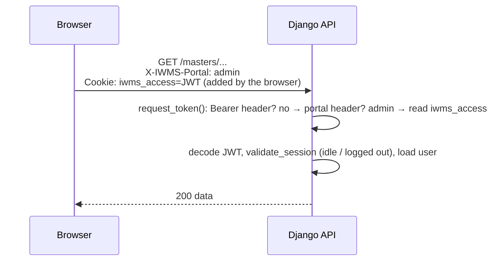
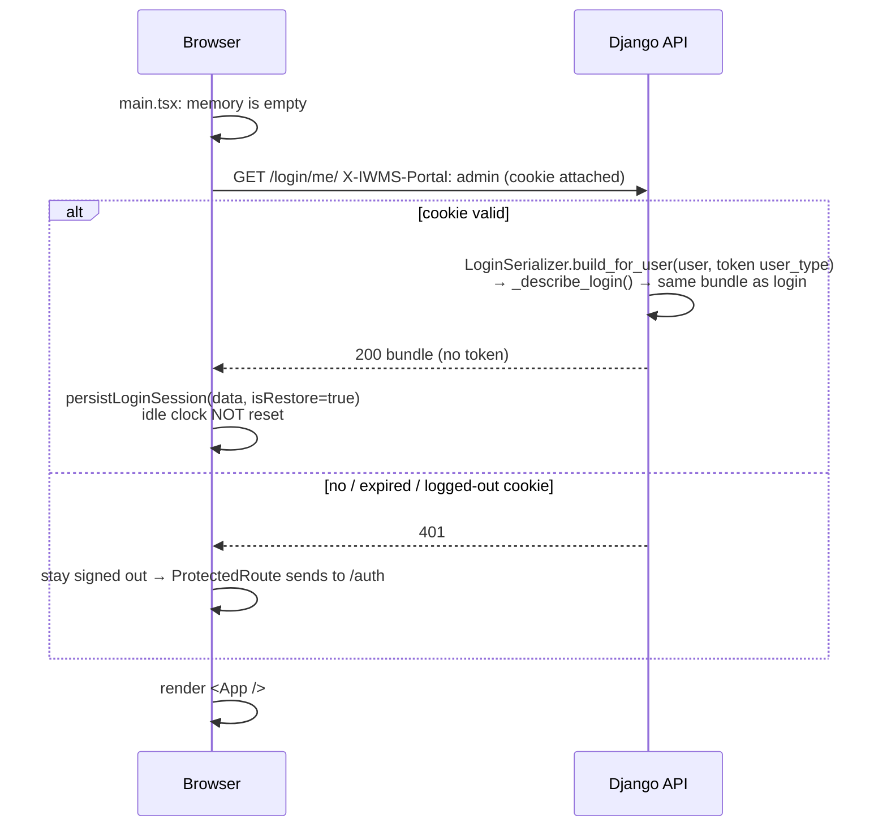

# Cookie Authentication (Web Portals)

How the web app signs users in, keeps them signed in across reloads, and
signs them out, now that **the access token lives in an HttpOnly cookie and
no user data is stored in the browser**. Covers what changed from the old
localStorage approach and why, how to use it when writing new code, how to
run it locally, and what to check before deploying.

> Flow charts are [Mermaid](https://mermaid.js.org/). GitHub renders them
> directly; in VS Code install **Markdown Preview Mermaid Support**.

**Contents**

1. [Summary](#1-summary)
2. [Why we changed it](#2-why-we-changed-it)
3. [Before vs after](#3-before-vs-after)
4. [How it works](#4-how-it-works)
5. [Backend reference](#5-backend-reference)
6. [Frontend reference](#6-frontend-reference)
7. [Writing new code: do and don't](#7-writing-new-code-do-and-dont)
8. [Advantages](#8-advantages)
9. [Trade-offs and limitations](#9-trade-offs-and-limitations)
10. [Local development setup](#10-local-development-setup)
11. [Deployment checklist](#11-deployment-checklist)
12. [Troubleshooting](#12-troubleshooting)
13. [Code map and tests](#13-code-map-and-tests)

---

## 1. Summary

- On a **web** login the backend puts the JWT in an **HttpOnly cookie**.
  JavaScript can never read it; the browser attaches it to API calls by
  itself.
- Each portal has its **own cookie**, so the admin, district and local body
  sessions in one browser never overwrite each other:

  | Portal | Cookie | Frontend API instance | Login page |
  |---|---|---|---|
  | Admin / dashboard | `iwms_access` | `api` | `/auth` |
  | District | `iwms_district_access` | `districtApi` | `/auth/district` |
  | Local body | `iwms_lb_access` | `lbApi` | `/auth/localbody` |

- Every web request sends an **`X-IWMS-Portal`** header (`admin`,
  `district` or `localbody`). It tells the backend which cookie to read and
  is also the CSRF guard: without the header the cookie is ignored.
- User, role, profile, permissions, projects and location scope are kept
  **in memory only** (`sessionStore`). On every page load the app calls
  **`GET /api/v1/login/me/`** to rebuild them from the cookie before the
  first render.
- The **mobile app is unchanged**: it sends no portal header, gets
  `access_token` in the login response, and uses `Authorization: Bearer`.

---

## 2. Why we changed it

Production security review does not allow the session token or the user's
data to be kept in `localStorage`:

- **Any script on the page can read localStorage.** One XSS bug, or one
  compromised npm package, and the attacker copies the token and uses it
  from their own machine for up to 5 hours (the token lifetime).
- The old setup also kept the user's profile, role, full permission map,
  project API URLs and location scope there in plain text, readable by
  anyone with access to the browser profile, and it **stayed there after
  the tab was closed**.

An HttpOnly cookie cannot be read by JavaScript at all, and data held only
in memory disappears when the tab closes.

---

## 3. Before vs after

### What is stored where

| Data | Before | After |
|---|---|---|
| Access token (admin) | `localStorage.access_token` | HttpOnly cookie `iwms_access` |
| Access token (district) | `localStorage.district_access_token` | HttpOnly cookie `iwms_district_access` |
| Access token (local body) | `localStorage.lb_access_token` | HttpOnly cookie `iwms_lb_access` |
| User, role, unique_id | `localStorage.user`, `user_role`, `unique_id` | memory (`sessionStore`) |
| Profile, project_id | `localStorage.profile`, `project_id` | memory |
| Permissions (3 maps) | `localStorage.permissions*` | memory |
| Projects + location scope | `localStorage.*_config` (9 keys) | memory |
| User name / email | `localStorage.user_name`, `user_email` | memory |
| District context | `localStorage.district_*` | memory |
| Local body context | `localStorage.lb_*` | memory |
| Token expiry / idle limit | decoded from the JWT in the browser | from the login / `me` response, in memory |
| Idle-timer timestamps | `localStorage.<tokenKey>__last_activity` | `localStorage.<portal>__last_activity` (unchanged idea) |
| Theme, language, map layer, admin view mode, list filters | `localStorage` | `localStorage` (unchanged) |

### How things behave

| Behaviour | Before | After |
|---|---|---|
| Sending the token | Axios interceptor added `Authorization: Bearer <token>` | Browser sends the cookie; axios sets `withCredentials: true` + `X-IWMS-Portal` |
| Login response (web) | Contained `access_token` | No token in the body; `Set-Cookie` instead |
| Login response (mobile) | Contained `access_token` | Same as before |
| Page reload | Read everything back from localStorage | One `GET /login/me/` before first render |
| "Am I signed in?" | Token exists in localStorage and not expired | Session info in memory and not expired (`isAuthSessionActive()`) |
| Logout | Delete localStorage keys | `POST /login/logout/` clears the cookie server-side + memory cleared |
| Logout in another tab | `storage` event | `BroadcastChannel("iwms-auth")` message |
| Data left after closing the tab | Everything, until logout | Nothing but the HttpOnly cookie (expires with the token) |
| CSRF exposure | None (Bearer header) | Guarded by the required `X-IWMS-Portal` header + `SameSite=Lax` |
| Token readable by an XSS script | Yes | No |

### Code-level comparison

**Sending a request — before** (`src/api/index.ts`):

```ts
api.interceptors.request.use((config) => {
  const token = localStorage.getItem("access_token");
  if (token && !isLogin) config.headers.Authorization = `Bearer ${token}`;
  return config;
});
```

**After:**

```ts
const api = axios.create({
  baseURL: API_ROOT,
  withCredentials: true,                       // send the cookie
  headers: { "X-IWMS-Portal": portal, ... },   // pick the cookie + CSRF guard
});
```

**Reading the role — before:** `localStorage.getItem(USER_ROLE_STORAGE_KEY)`
**After:** `sessionStore.getItem(USER_ROLE_STORAGE_KEY)`

**District login — before:** read `access_token` from the response and
write five `localStorage` keys by hand.
**After:** `districtApi.post("/login/login-user/", ...)` then
`persistDistrictSession(res.data)`.

---

## 4. How it works

### 4.1 Login

```mermaid
sequenceDiagram
    participant B as Browser (React)
    participant A as Django API
    B->>A: POST /login/ {username, password, client:"web"}<br/>X-IWMS-Portal: admin
    A->>A: LoginSerializer validates, _describe_login() builds the bundle,<br/>mint JWT, create LoginAudit row
    A-->>B: 200 {user, role, permissions, projects, ..., expires_at,<br/>login_audit_id, idle_timeout_seconds}<br/>Set-Cookie: iwms_access=JWT; HttpOnly; SameSite=Lax; Max-Age=18000
    B->>B: persistLoginSession(payload) → sessionStore (memory)<br/>startLoginSession("admin") → idle clock starts
    B->>B: navigate to dashboard
```

No `/login/me/` call happens here: the login response already carries the
whole bundle.

### 4.2 Every API call



The same `request_token()` helper is used by the DRF authentication class,
the module-permission middleware, logout/heartbeat and the Excel export
replay, so every path accepts both the cookie and the Bearer header.

### 4.3 Page reload (session restore)



Which portal is restored depends on the URL's first segment: `/district…`
→ district, `/localbody…` → local body, `/auth…` → none, anything else →
admin.

Because `/login/me/` rebuilds the data from the database, a reload also
picks up changes made since login (new permissions, renamed project, etc.).

### 4.4 Idle timeout, heartbeat and logout

Unchanged in behaviour, only the source of the facts moved:

- The idle limit (`idle_timeout_seconds`, 40 min by default) and token
  expiry (`expires_at`) come from the login / `me` response instead of
  decoding the JWT in the browser.
- `useIdleLogout({ portal })` checks every 15 s, sends
  `POST /login/heartbeat/` after real user activity, and on idle / expiry
  calls `POST /login/logout/` with the reason.
- Logout **always** returns a `Set-Cookie` that deletes the portal's
  cookie, even if no session row matched.
- The server still enforces the idle limit on every request
  (`validate_session`), so an idle cookie is rejected even if the browser
  guard never ran.

### 4.5 Multiple tabs

- Activity timestamps are still shared through `localStorage`, so activity
  in any tab keeps the session alive.
- Memory is per tab, so on logout the tab posts `{portal}` on
  `BroadcastChannel("iwms-auth")`; other tabs drop that portal's session
  and their idle guard sends them to the login page.
- A tab opened later restores itself through `/login/me/` like a reload.

### 4.6 Why the `X-IWMS-Portal` header is also the CSRF guard

A cookie is sent by the browser automatically, so another site could try
to make the browser call our API with it (CSRF). Two layers stop that:

1. `SameSite=Lax` — browsers don't attach the cookie to cross-site
   `fetch`/XHR or cross-site POSTs.
2. The backend **only reads the cookie when `X-IWMS-Portal` is present**.
   A custom header forces a CORS preflight, and the preflight only
   succeeds for origins in `CORS_ALLOWED_ORIGIN_REGEXES`. Layer 2 matters
   here because other apps on the same IP but a different port count as the
   *same site* for `SameSite`.

---

## 5. Backend reference

### 5.1 Endpoints

| Method | URL | Auth | Purpose |
|---|---|---|---|
| POST | `/api/v1/login/` and `/api/v1/login/login-user/` | none | Login. With `X-IWMS-Portal` → sets that portal's cookie, no `access_token` in the body. Without → returns `access_token` (mobile). |
| GET | `/api/v1/login/me/` | cookie or Bearer | **New.** Returns the login bundle (minus token) + `expires_at`, `login_audit_id`, `idle_timeout_seconds`. 401 if not signed in or the account no longer resolves. |
| POST | `/api/v1/login/logout/` | cookie or Bearer (expiry not checked) | Closes the LoginAudit session and deletes the portal cookie. |
| POST | `/api/v1/login/heartbeat/` | cookie or Bearer | Records activity; 401 once the session has ended. |
| GET | `/api/v1/login/my-permissions/` | cookie or Bearer | Unchanged. |

New fields in the login response: `expires_at` (epoch seconds). Removed for
web only: `access_token`.

### 5.2 Cookie attributes

| Attribute | Value | Why |
|---|---|---|
| `HttpOnly` | always | JS can't read it |
| `SameSite` | `Lax` (setting `AUTH_COOKIE_SAMESITE`) | not sent on cross-site requests |
| `Secure` | `AUTH_COOKIE_SECURE` (default `false`) | must be `true` on HTTPS; browsers drop Secure cookies on HTTP |
| `Max-Age` | token lifetime (5 h) | cookie dies with the token |
| `Path` | `/` | |
| `Domain` | `AUTH_COOKIE_DOMAIN` (default: API host only) | |

### 5.3 Settings / environment variables

In `config/settings_jwt.py`:

| Env var | Default | Notes |
|---|---|---|
| `AUTH_COOKIE_SECURE` | `false` | Set `true` once the site is on HTTPS |
| `AUTH_COOKIE_SAMESITE` | `Lax` | `None` only for cross-site setups, and then `Secure` must be `true` |
| `AUTH_COOKIE_DOMAIN` | unset | Leave unset unless frontend and API are on sibling subdomains |

In `config/settings.py`: `CORS_ALLOW_HEADERS` now includes `x-iwms-portal`
(on top of the django-cors-headers defaults). `CORS_ALLOW_CREDENTIALS =
True` was already set.

### 5.4 Token resolution rules (`app/authentication/cookies.py`)

```text
request_token(request):
  1. Authorization: Bearer <token>   → use it              (mobile, tools)
  2. X-IWMS-Portal: <portal>         → use that portal's cookie
  3. otherwise                       → no token (cookie ignored)
```

`JWTUserAuthentication` treats a **bad Bearer token** as a hard 401 (as
before) but a **bad cookie** as "not signed in". Otherwise an expired
cookie would make the public login endpoint itself return 401, because DRF
authenticates every request eagerly.

### 5.5 Session rebuild (`/login/me/`)

- `LoginSerializer.build_for_user(user, user_type)` picks the same builder
  login uses (`_build_staff_payload`, `_build_district_payload`,
  `_build_customer_payload`, `_build_platform_payload`, the leader builders)
  based on the user's model and the token's `user_type` claim. No password
  is involved.
- `_describe_login(data)` in `login_viewset.py` (pulled out of `create()`)
  turns that into the role / name / profile bundle. **Login and `me` share
  it**, so a reload produces exactly what login produced.

---

## 6. Frontend reference

### 6.1 Modules

| File | Role |
|---|---|
| `src/api/index.ts` | `api`, `districtApi`, `lbApi` (one per portal, all `withCredentials` + `X-IWMS-Portal`), `apiForPortal(portal)`, `Portal` type |
| `src/utils/sessionStore.ts` | In-memory `getItem / setItem / removeItem` — the replacement for localStorage for user data |
| `src/utils/authStorage.ts` | `persistLoginSession`, `persistDistrictSession`, `persistLocalBodySession`, their `clear*` functions, all `getStored*` readers, `isAuthSessionActive()`, **`restoreAuthSession()`** |
| `src/utils/loginSession.ts` | Per-portal session facts (expiry, idle limit, audit id), activity timestamps, `endLoginSession`, `sendSessionHeartbeat`, cross-tab broadcast |
| `src/hooks/useIdleLogout.ts` | `useIdleLogout({ portal, onSessionEnd })` |
| `src/main.tsx` | Awaits `restoreAuthSession()` before rendering |

### 6.2 Common tasks

**Call the backend** (the cookie is attached automatically):

```ts
import { api } from "@/api";
const { data } = await api.get("/masters/wards/");
```

District / local body pages use `districtApi` / `lbApi`.

**Read who is signed in:**

```ts
import { getStoredAuthUser, getStoredProfile, getStoredProjects } from "@/utils/authStorage";
import { getStoredPermissions } from "@/utils/permissions";
import { sessionStore } from "@/utils/sessionStore";
import { USER_ROLE_STORAGE_KEY, normalizeRole } from "@/types/roles";

const role = normalizeRole(sessionStore.getItem(USER_ROLE_STORAGE_KEY));
```

All of these are synchronous and safe to call during the first render,
because `main.tsx` restores the session before rendering.

**Check whether the admin app is signed in:** `isAuthSessionActive()`.

**Sign out (admin):**

```ts
await endLoginSession("admin", "manual");   // audit + server clears the cookie
clearAuthSession();                         // clear memory
navigate("/auth", { replace: true });
```

District: `endLoginSession("district")` + `clearDistrictSession()`.
Local body: `endLoginSession("localbody")` + `clearLocalBodySession()`.

**Guard a page with the idle timeout:**

```ts
useIdleLogout({ portal: "district", onSessionEnd: () => { ... } });
```

---

## 7. Writing new code: do and don't

| Do | Don't |
|---|---|
| Call the backend through `api` / `districtApi` / `lbApi` | Use bare `axios.create()` or `fetch()` for backend calls; they won't send the portal header, so the cookie is ignored and you get 401 |
| Read user data with `getStored*()` or `sessionStore.getItem()` | Put user, role, profile, permissions or project data in `localStorage` / `sessionStorage` |
| Keep pure UI preferences (theme, a filter, a collapsed panel) in `localStorage` | Try to read the token; there is no token in JS any more |
| Add new login response fields to `_describe_login` + `_SESSION_FIELDS` so `me` returns them too | Add a field only in `create()`; it would vanish after a reload |
| Use `persistLoginSession(payload)` after a login | Write session keys by hand |
| For a new portal: add it to `PORTAL_COOKIES` (backend), `Portal` + `createApi` (frontend), and `PERSIST_BY_PORTAL` / `portalForPath` | Reuse another portal's API instance; it would overwrite that portal's cookie |

If you need a file download or image from an authenticated endpoint, fetch
it with the API instance (`responseType: "blob"`). A plain `<a href>` or
`` sends the cookie but **not** the portal header, so the backend
will treat it as unauthenticated.

---

## 8. Advantages

1. **The token can't be stolen by XSS.** The worst an injected script can
   do is make requests while the victim's tab is open. It can't take the
   token away and reuse it later.
2. **No user data at rest in the browser.** Profile, permissions, project
   API URLs and scope never touch disk, and vanish when the tab closes.
3. **Fresh data on reload.** `/login/me/` rebuilds the bundle from the
   database, so permission or project changes show after a refresh instead
   of only after re-login.
4. **Server-controlled logout.** Logout deletes the cookie from the
   server, and expiry is enforced by the cookie's `Max-Age` as well as the
   JWT's `exp`.
5. **Portals stay isolated.** Separate cookies mean an admin and a local
   body leader can be signed in in the same browser without clobbering
   each other (the old code relied on everyone remembering to use the right
   localStorage key).
6. **Less auth code in the frontend.** No interceptor, no JWT decoding, no
   token plumbing in the dashboards; logins share `persist*Session`
   helpers.
7. **Mobile unaffected.** Same endpoints, same Bearer flow.
8. **Passes the "no sensitive data in localStorage" review item.**

---

## 9. Trade-offs and limitations

| Item | Detail |
|---|---|
| One extra request per page load | `GET /login/me/` runs before the first render, so the app appears slightly later on a cold load (one round-trip). |
| Frontend and API must be the **same site** | `SameSite=Lax` cookies are only sent when the frontend and API share a host (ports may differ). `localhost` vs `127.0.0.1` count as **different sites**. Production (`115.245.93.26:4126` → `:4216`) is fine. |
| HTTP in production | Without HTTPS the cookie can't be `Secure`, so it can be read off an unencrypted network. Enable HTTPS and set `AUTH_COOKIE_SECURE=true`. |
| Cross-site setups need HTTPS | A frontend on a different host from the API (e.g. a developer's own LAN IP calling a shared API) needs `AUTH_COOKIE_SAMESITE=None` + `AUTH_COOKIE_SECURE=true`, which requires HTTPS. |
| Cross-tab login | Signing in as a *different* user in one tab replaces the shared cookie; other open tabs keep showing the old user's data until they reload. Logout is broadcast; login isn't. |
| Plain links to protected files | `<a href>` / `` to authenticated endpoints don't send the portal header (see section 7). |
| Everyone re-logs in once | Old localStorage tokens are ignored after the deploy. |

---

## 10. Local development setup

The frontend and the API must use the **same hostname**:

```env
# iwms-frontend/.env
VITE_API_LOCAL=http://localhost:8000/api/v1
```

Open the app at `http://localhost:5173`. Restart `npm run dev` after any
`.env` change; Vite only reads it at startup.

Using `http://127.0.0.1:8000` for the API while browsing at `localhost:5173`
(or the other way round) makes every request **cross-site**: the login sets
the cookie, but the browser never sends it back, and every API call returns
401.

---

## 11. Deployment checklist

1. Deploy backend and frontend **together**: an old frontend can't use
   the new web login (no token in the body), and the new frontend needs
   `/login/me/`.
2. Frontend and API on the same host (ports may differ). Production
   `FRONTEND_LIVE_URL` and `VITE_API_PROD` must share the IP / domain.
3. The frontend origin is matched by `CORS_ALLOWED_ORIGIN_REGEXES`.
4. If served over HTTPS: `AUTH_COOKIE_SECURE=true`.
5. If a reverse proxy sits in front of Django, it must pass through the
   `Cookie`, `Set-Cookie` and `X-IWMS-Portal` headers.
6. Tell users they'll need to sign in once after the release.

---

## 12. Troubleshooting

| Symptom | Cause | Fix |
|---|---|---|
| Login works, then every request is **401**; DevTools shows `Sec-Fetch-Site: cross-site` | Frontend and API on different hostnames (`localhost` vs `127.0.0.1`) | Use the same hostname (section 10), delete the old cookie, sign in again |
| Cookie not set at all after login | Request had no `X-IWMS-Portal`, or `AUTH_COOKIE_SECURE=true` on plain HTTP | Use the shared API instances; only enable Secure on HTTPS |
| CORS error mentioning `x-iwms-portal` | Backend missing `CORS_ALLOW_HEADERS` change, or origin not in the allowlist | Deploy the backend settings; add the origin regex |
| Can't see `me/` in the Network tab after login | Expected. `me/` runs only on page load | Press F5 with DevTools open and filter by `me` |
| Reload sends you to `/auth` | `me/` returned 401: cookie expired (5 h), session idle-closed, or logged out in another tab | Sign in again. If unexpected, check the `me/` response `detail` |
| A download / image link returns 401 | Plain link sends no portal header | Fetch it through the API instance as a blob |
| "Only the token is in Cookies, where is the user data?" | By design: user data lives in memory, never in cookies or storage | Inspect the `login/` or `me/` response instead |

---

## 13. Code map and tests

**Backend**

| File | Change |
|---|---|
| `app/authentication/cookies.py` | **New.** Portal → cookie map, `request_token`, `set_auth_cookie`, `clear_auth_cookie` |
| `app/authentication/jwt.py` | Reads token via `request_token`; a bad cookie = unauthenticated |
| `app/middleware/module_permission_middleware.py` | Reads token via `request_token`; `login/me/` is auth-only |
| `app/viewsets/login/login_viewset.py` | `_describe_login` / `_session_body` extracted; login sets cookie; logout clears it; new `me` action |
| `app/serializers/login/login_serializer.py` | `build_for_user`, `_build_user_payload` |
| `app/services/excel_export.py` | Replayed export requests forward `Cookie` + `X-IWMS-Portal` |
| `config/settings.py`, `config/settings_jwt.py` | `CORS_ALLOW_HEADERS`, `AUTH_COOKIE_*` |

**Frontend**

| File | Change |
|---|---|
| `src/api/index.ts` | Per-portal instances with `withCredentials` + `X-IWMS-Portal`; Bearer interceptor removed |
| `src/utils/sessionStore.ts` | **New.** In-memory store |
| `src/utils/authStorage.ts` | Memory instead of localStorage; district / local body persistence; `restoreAuthSession`; `isAuthSessionActive` |
| `src/utils/loginSession.ts` | Keyed by portal; no JWT decoding; cross-tab logout broadcast |
| `src/hooks/useIdleLogout.ts` | `portal` option instead of `tokenKey` |
| `src/main.tsx` | Restore before first render |
| `DistrictAuth.tsx`, `LocalBodyAuth.tsx`, both leader dashboards | Use `districtApi` / `lbApi` and the shared persist / clear helpers |
| `ProtectedRoute`, `RolesContext`, `ProjectSelectorContext`, `UserContext`, layouts, hooks, `permissions.ts`, `projectContext.ts`, `WardForm` | `localStorage` → `sessionStore` for user data; token checks → `isAuthSessionActive()` |

**Tests:** `tests/login/test_api/test_login_cookie.py`

```bash
.venv/bin/python -m pytest tests/login/test_api/test_login_cookie.py -q
```

Covers: HttpOnly cookie set and token hidden on web login; mobile login
still returns the token; cookie accepted only with the portal header; one
portal's cookie not usable by another; `/login/me/` restore and 401 when
signed out; logout clears the cookie and ends the session; login still
works with a stale cookie.
